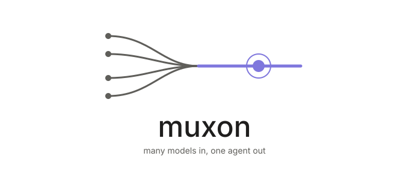

<p align="center">
  
</p>

# muxon

Monorepo for **muxon**: an open-source, CLI-first coding agent harness that runs any model from any provider (open or frontier, hosted or local) from one place, optimized for the weakest model so it holds up on all of them (verify-gated `finish`, local JSONL traces). Product overview: [docs/product.md](docs/product.md).

| Path | What it is |
|------|------------|
| [`harness/`](harness/) | Go module — `muxon` CLI and all runtime code |
| [`api/`](api/) | Placeholder for the closed inference API module (not implemented here) |
| [`docs/`](docs/) | Architecture specs, research, benchmarks |

**Status:** Milestones **M0**, **A** (headless), **B** (TUI), **C** (replay and local eval report), and **D** (release stubs) are in the tree. Scripted `muxon run` and `muxon chat` can fix [`go-failing-test`](harness/testdata/fixtures/go-failing-test). Live model-matrix scoring, probe thresholds, and a tagged release are still open. See [implementation plan](docs/harness-architecture/implementation-plan.md). The module path is still `github.com/PLACEHOLDER/muxon/harness`.

---

## Prerequisites

- **Go 1.24+** ([install](https://go.dev/doc/install))
- **Git**
- For upcoming tools: **ripgrep** (`rg`) — CI installs it; optional locally until Part 2

---

## Get started

### Clone and build

```bash
git clone git@github.com:adavila0703/muxon-harness.git
cd muxon-harness
```

The repo uses a [Go workspace](go.work); harness code lives under `harness/`. You can stay at the **repo root** for most commands.

**Task shortcuts** (optional, works on Windows, macOS, and Linux; install from [taskfile.dev](https://taskfile.dev/installation/)):

```bash
task                # list tasks
task build          # → harness/muxon (harness/muxon.exe on Windows)
task muxon -- version
task test
```

**Make shortcuts** (optional, Unix only):

```bash
make help
make build          # → harness/muxon
make muxon ARGS=version
make test
```

**Go directly** (same as above, no Make):

```bash
go run ./harness/cmd/muxon version
go build -o harness/muxon ./harness/cmd/muxon
go test ./harness/...
```

Equivalent from inside `harness/`:

```bash
cd harness
go build -o muxon ./cmd/muxon
go test ./...
```

### Environment

| Variable | Default | Purpose |
|----------|---------|---------|
| `MUXON_HOME` | `~/.muxon` | Config, catalog, trust store (tests should set this to a temp dir) |
| `MUXON_SCRIPTED_PROVIDER_FILE` | — | Path to a JSON file of canned model responses (CI / demos; overrides BYOK when set) |
| `MUXON_TRUST` | — | Set to `1` to trust the workspace (same as `--trust`) |
| `DEEPINFRA_API_KEY` (etc.) | — | Provider keys per embedded `models.yaml` / `~/.muxon/catalog.json` |

`muxon` also reads the nearest `.env` at or above the current directory, stopping at the repo root. Shell variables win over the file. To set it up, copy [`.env.example`](.env.example) to `.env` and fill in your keys.

---

## Install

Release archives are built with [`.goreleaser.yml`](.goreleaser.yml) (`linux`, `darwin` and `windows`, `amd64` and `arm64`) when a `vX.Y.Z` tag is pushed; versions and `CHANGELOG.md` come from [changesets](.changeset/README.md). See [docs/RELEASING.md](docs/RELEASING.md). No release is tagged yet. Until then:

```bash
go build -o muxon ./harness/cmd/muxon
```

## Commands (milestone D)

| Command | Description |
|---------|-------------|
| `muxon` / `muxon chat` | Interactive TUI |
| `muxon run` | Headless agent session |
| `muxon resume [session-id]` | Continue the newest session, or a named one |
| `muxon doctor` | Keys, providers, `rg` on PATH (never prints secrets) |
| `muxon cost` | Token and USD totals from the latest session trace |
| `muxon trust list\|add\|rm` | Workspace trust store under `MUXON_HOME` |
| `muxon models list\|show\|probe` | Merged manifest; probe writes a catalog snippet |
| `muxon auth login <provider>` | Keyring entry; catalog records the provider id only |
| `muxon trace record\|replay\|export` | Scripted replay file, load it, or redact a trace |
| `muxon eval run\|report` | Local basket row and aggregate report |
| `muxon gc` | Drop session dirs older than 14 days and `refs/muxon/sessions/*` |
| `muxon completion bash\|zsh\|fish` | Shell completion |
| `muxon serve` | Exits 3; IDE protocol is not in this build |
| `muxon version` | Print build version |

Eval task ids: `fix-test-001`, `feature-add-001`, `lint-two-file-001`, `dep-bump-001`, `rename-001`.

Global flags: `-C` / `--directory`, `--json`, `-q` / `--quiet`, `-v` / `--verbose`.

### `muxon run`

```text
muxon run -p "<goal>" [--trust] [--verify-cmd "..."] [--model <id>] [--max-tool-rounds N]
         [--cost-budget-usd X] [--permission edit|full|read-only] [--yolo] [--no-plan]
         [--eval <task.json>]
```

| Flag | Description |
|------|-------------|
| `-p`, `--prompt` | Goal text (required) |
| `--trust` | Honor project verify command in the workspace |
| `--verify-cmd` | Override verify argv (whitespace-separated) |
| `--model` | Force worker model id from manifest |
| `--max-tool-rounds`, `--cost-budget-usd` | Per-run caps |
| `--permission`, `--yolo` | Tier / auto-approve within user `max_permission` |
| `--no-plan` | Skip planning (v1 records only; no planning state) |
| `--eval` | Append a row to `.muxon/eval/results.jsonl` after the run |

**Exit codes:** `0` done · `1` failed (verify/budget/caps) · `2` approval required · `3` setup · `130` cancelled (SIGINT).

**Provider:** Without `MUXON_SCRIPTED_PROVIDER_FILE`, `muxon run` uses the **worker** role from merged `models.yaml` + `~/.muxon/catalog.json` (BYOK). Set the provider’s `api_key_env` in your environment.

### Scripted M0 demo (fix the sample fixture)

1. Copy the fixture somewhere safe (the harness mutates the tree):

   ```bash
   cp -R harness/testdata/fixtures/go-failing-test /tmp/go-failing-test
   ```

2. Write the scripted responses (same sequence as [`director.M0ScriptedResponses`](harness/internal/director/director.go)) — or export them once from a small Go snippet / test helper.

3. Run:

   ```bash
   export MUXON_SCRIPTED_PROVIDER_FILE=/path/to/script.json
   export MUXON_HOME="${TMPDIR:-/tmp}/muxon-home"
   cd harness
   go run ./cmd/muxon run -p "fix the failing test" --trust --directory /tmp/go-failing-test
   ```

4. Inspect the trace (session id is timestamped; `muxon cost` reads the latest):

   ```text
   /tmp/go-failing-test/.muxon/sessions/<session-id>/trace.jsonl
   ```

   Expect `verify.run` (passed) and `session.end` with `outcome` `done`.

---

## Development

From the repo root:

```bash
make fmt test vet    # or: gofmt -w harness/ && go test ./harness/... && go vet ./harness/...
make lint            # golangci-lint in harness/
```

Lint (optional, matches CI):

```bash
cd harness
golangci-lint run
```

GitHub Actions runs test, vet, lint, and build on **linux** and **macOS** for changes under `harness/`.

---

## Documentation

| Topic | Link |
|-------|------|
| Architecture index | [docs/harness-architecture/README.md](docs/harness-architecture/README.md) |
| Implementation plan & milestones | [docs/harness-architecture/implementation-plan.md](docs/harness-architecture/implementation-plan.md) |
| CLI & TUI (target) | [docs/harness-architecture/cli.md](docs/harness-architecture/cli.md) |
| Closed API (separate module) | [docs/api/README.md](docs/api/README.md) |

---

## Module path

`harness/go.mod` currently uses `github.com/PLACEHOLDER/muxon/harness`. Replace `PLACEHOLDER` with your GitHub org or username before publishing the module or cutting releases.

---

## License

License file not added yet; treat as private development until you declare one.
