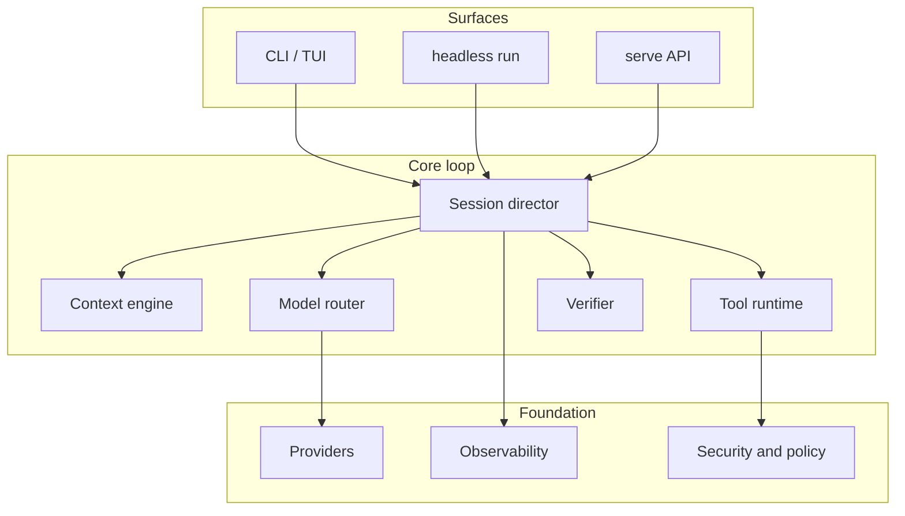

# muxon — architecture

**Status:** Pre-implementation specification. It describes the whole harness, every piece it needs, not a sequence of releases.

## Purpose

muxon is a **frugal, model-agnostic coding agent**: one CLI-first loop that drives **any model from any surface** (frontier APIs, aggregators, our inference, local runtimes) from a single place. The loop is **optimized for the weakest supported model**: **tight context**, **tool-native repo access**, and **verification gates** that hold up on a small open model hold up on every model, so stronger models need no separate path. Small open models are the cheap default, not the only target.

The same loop runs **any** model, from an 8B open model to a frontier model. What changes per model is read from its **capability profile** (tool-calling protocol, edit format, context window, tokenizer, caching), not hard-coded for one class. OpenCode is the reference for what we avoid: a loop tuned for frontier tool calling that degrades on small models. The design takes the pieces that work from Aider (edit formats, repo map, test-in-repair-loop), Ante (profiles, local models, catalog), SWE-agent and zeroshot (verifier-gated loops), and the harness-ablation research, and combines them.

Inference uses **OpenAI-compatible** APIs. We ship a **recommended default** manifest (e.g. [DeepInfra](../research/01-deepinfra.md) SKUs for frugal OSS)—but users always **bring their own keys (BYOK)** and can point at any supported provider. The harness is not tied to our billing or a single vendor; [our API](../api/README.md) is one provider among many, not a requirement. Anthropic and OpenAI get native adapters so frontier escalation keeps caching and reasoning intact.

The harness owns **tokens, routing, and trust**; providers own **inference**.

## Product invariants

| Invariant | Meaning |
|-----------|---------|
| **BYOK** | User supplies API keys (env, keychain, or `catalog.json`). No account required to run the CLI against your own DeepInfra, OpenRouter, Anthropic, local Ollama, etc. |
| **Model-agnostic** | Swappable providers via one adapter interface; default `models.yaml` is a curated starting point, fully overridable. |
| **Capability-adaptive** | Tool protocol, output constraint, edit format, prompt wording, sampling, reasoning handling, and budgets follow the bound model's capability profile. Unknown models get safe defaults; `muxon models probe` measures the rest. |
| **Fail cheap, not loud** | A slip a small model makes (an in-text call, a trailing comma, a repeated read) is caught by the harness before it costs a model turn. |
| **Token budget** | Per-session and per-task caps; compaction before “just use a bigger window.” |
| **Verify before done** | No terminal success on a changed workspace without a harness-run evidence step (tests, lint, or manual approval). Exhausted budgets and caps end as `failed`, never `done`. |
| **Trust before execution** | Repo-supplied hooks, verify commands, skills, and config are honored only in a trusted workspace. |
| **ZDR by default** | Prompts/completions stay on the client; remote proxy logs metadata only. |
| **Escalate on evidence** | Cheap worker model first; larger model only when triggers fire. |
| **Cost visible** | Every turn reports input/output tokens and estimated $. |

## Small-model strategy: two pillars

Most failures on 8B–32B workers are not “the model can’t code” — they are **(1) too much or wrong context** and **(2) invalid or wrong tool calls**. Frontier harnesses (e.g. OpenCode) often assume both are easy: wide tool schemas in every prompt, LSP dumps, and several native calls per turn. muxon inverts that: **the harness gathers and shapes context; the model requests more with tools.**

| Pillar | OpenCode-style failure | muxon response | Spec |
|--------|------------------------|---------------|------|
| **Smart context** | Whole-repo or huge tool/LSP payloads in history | Retrieve → rank → bounded `read`; prefix caps; compaction; no auto file paste | [context-engine.md](./context-engine.md#retrieval-pipeline), [repo-map](./tools/repo-map.md) |
| **Reliable tool calling** | Full `tools[]` + parallel native calls | Phase-gated active tools; `two_step` / `fenced`; constrain → salvage → repair → escalate | [tools/README.md](./tools/README.md#tool-calling-on-small-models), ADR-008/010 |

Both pillars share the **capability profile** ([model-router.md](./model-router.md#capability-profile)) and **observability** (`malformed_call_rate`, `salvage_rate`, `prefix_hash`, `cost_per_done`) so the eval matrix can prove the small-model row, not only frontier.

## Logical architecture

```text
┌─────────────────────────────────────────────────────────────┐
│  Surfaces: CLI · headless run · serve / IDE                 │
├─────────────────────────────────────────────────────────────┤
│  Session director — state machine, plan, checkpoints        │
├──────────────┬──────────────┬──────────────┬────────────────┤
│  Context     │  Model       │  Tool        │  Verifier      │
│  engine      │  router      │  runtime     │                │
├──────────────┴──────────────┴──────────────┴────────────────┤
│  Provider adapters (BYOK — user keys, any OpenAI-compatible host) │
├─────────────────────────────────────────────────────────────┤
│  Observability — JSONL traces, metrics, eval hooks          │
└─────────────────────────────────────────────────────────────┘
         ▲
         │  Security & policy wraps tool + shell + egress
```



## Component documentation

| Component | Doc | Responsibility |
|-----------|-----|----------------|
| **CLI surface** | [cli.md](./cli.md) | Commands, flags, TUI layout, slash commands, headless vs interactive |
| Session director | [session-director.md](./session-director.md) | State machine, planning phase, checkpoints, resume, turn lifecycle |
| Context engine | [context-engine.md](./context-engine.md) | Retrieval, prompt layout, compaction, cache-friendly prefixes |
| Model router | [model-router.md](./model-router.md) | Classifier / worker / escalator roles, triggers, manifests |
| Tool runtime | [tool-runtime.md](./tool-runtime.md) | Execution, permissions, token caps. Tools: [tools/README.md](./tools/README.md) |
| Verifier | [verifier.md](./verifier.md) | Test/lint hooks, `finish` gate, failure → router |
| Providers | [providers.md](./providers.md) | BYOK, adapters, streaming, tiers, failover |
| Observability | [observability.md](./observability.md) | Traces, cost accounting, eval basket |
| Security & policy | [security-and-policy.md](./security-and-policy.md) | ZDR, permissions, audit (team tier) |
| **Tech stack** | [tech-stack.md](./tech-stack.md) | **Go**, repo layout, libraries, build/release |
| OSS comparison | [oss-comparison.md](./oss-comparison.md) | OpenCode, Aider, Ante, Pi, Goose vs each component |
| ADRs | [adrs.md](./adrs.md) | Decisions and open questions |
| **Implementation plan** | [implementation-plan.md](./implementation-plan.md) | Build phases, packages, milestones (OSS harness only) |

## Typical request flow (one turn)

1. **Session director** checks workspace trust, accepts user goal; router classifies it (`change` | `question`); may enter `planning` or `acting`.
2. **Context engine** builds the next prompt: stable prefix (rules, tool catalog, `AGENTS.md`, repo map) + compacted history + retrieved snippets + phase line + user message.
3. **Model router** selects role (`router` | `worker` | `escalated`) and provider SKU; the model's capability profile picks the tool protocol, output constraint, edit format, prompt variant, and sampling.
4. **Providers** stream the completion through the provider's native adapter; reasoning is split off before anything parses the reply.
5. **Tool runtime** takes the call in order: constrained output, salvage of in-text or slightly broken calls, schema validation, then one repair turn if still needed. It executes under policy; results are wrapped by trust level, truncated, and fed back.
6. **Session director** checks caps, budgets, and the loop detector before the next turn.
7. On `finish`, the **verifier** runs the project's verify command as a harness subprocess. Loop until it passes (`done`), a cap, budget, or loop runs out (`failed`), or the user cancels (`cancelled`).
8. **Observability** appends JSONL events with token and $ totals and the harness-quality signals (parse, salvage, loop, truncation).

## Research context

Background lives under [`docs/research/`](../research/):

- [Harness landscape](../research/02-harness-landscape.md)
- [Awesome CLI agents survey](../research/03-awesome-cli-coding-agents-survey.md)
- [DeepInfra](../research/01-deepinfra.md)

## The pieces, and where each comes from

Everything the harness needs to make a small model do real work, grouped by the problem it solves. "From" names the harness or research we take it from; the comparison with each one is in [oss-comparison.md](./oss-comparison.md).

### Getting a valid action out of the model

| Piece | From | Spec |
|-------|------|------|
| Per-model capability profile (protocol, edit format, window, tokenizer, cache) | Ante profiles, Aider model settings | [model-router.md](./model-router.md#capability-profile) |
| Three tool protocols: `native`, `two_step`, `fenced` | Aider (text edits), Goose toolshim (text calls) | [tools/README.md](./tools/README.md#tool-calling-protocols) |
| Constrained decoding to the tool schema or a grammar | vLLM / llama.cpp / Ollama structured output | [tools/README.md](./tools/README.md#constrained-decoding) |
| Salvage of in-text and slightly broken calls | Hermes / Qwen tool-call formats, server-side tool parsers | [tools/README.md](./tools/README.md#salvage-before-repair) |
| Small active tool set per phase, constant `tools[]` | arXiv:2609.20804 ablations, Ante | [tools/README.md](./tools/README.md#tool-calling-on-small-models) |
| Per-model edit format and apply ladder | Aider | [tools/patch.md](./tools/patch.md) |
| Prompt variants (`compact`, `standard`) and per-model sampling | Vendor model cards, Aider per-model prompts | [context-engine.md](./context-engine.md#prompt-variants) |
| Probe to calibrate an unknown model | Aider benchmark, Ante catalog | [model-router.md](./model-router.md#probe) |

### Keeping the model inside its window

| Piece | From | Spec |
|-------|------|------|
| Cache-stable prompt layout | Provider caching guides | [context-engine.md](./context-engine.md#prompt-layout-cache-friendly) |
| Retrieve, don't paste: search, bounded read, repo map | Aider repo map, Zap index | [context-engine.md](./context-engine.md#retrieval-pipeline) |
| Elide, truncate, then summarize | arXiv:2609.20804, CliffCompaction, Keen Code TurnMemory | [context-engine.md](./context-engine.md#compaction-pipeline) |
| Measured `served_context` and window-scaled prefix | Ollama and llama.cpp failure reports | [context-engine.md](./context-engine.md#small-windows) |
| Reasoning separated, and stripped or kept per model | Provider API rules (DeepSeek, Qwen, Anthropic, OpenAI) | [providers.md](./providers.md#reasoning-content) |

### Knowing when the work is done, or stuck

| Piece | From | Spec |
|-------|------|------|
| Harness-run verify, baseline, failure bundle | SWE-agent, Aider test loop, zeroshot | [verifier.md](./verifier.md) |
| Verify-gaming protection | Benchmark graders | [verifier.md](./verifier.md#verify-gaming) |
| Loop detection with nudge, escalate, fail | Observed small-model behavior; trace data we already keep | [session-director.md](./session-director.md#loop-detection) |
| Hard caps and budgets that end in `failed` | MartinLoop | [session-director.md](./session-director.md#caps-and-budgets) |
| Escalate on evidence | Aider architect/editor, research basket | [model-router.md](./model-router.md#escalation-triggers) |

### Working with any provider

| Piece | From | Spec |
|-------|------|------|
| BYOK and a user catalog | Ante `catalog.json` | [providers.md](./providers.md#bring-your-own-keys-byok) |
| Native adapters: OpenAI-compatible, Anthropic Messages, OpenAI Responses | Pi unified provider API, OpenCode provider breadth | [providers.md](./providers.md#adapters) |
| Local-server handling (`num_ctx`, tool parsers, concurrency) | Ante llama.cpp, Nanocoder Ollama | [providers.md](./providers.md#local-and-self-hosted-servers) |
| Capabilities published by gateways and our API | LiteLLM model info | [providers.md](./providers.md#capability-fields) |
| Normalized usage and cost, including cache writes and reasoning | Ante pricing table | [model-router.md](./model-router.md#cost-accounting) |

### Running safely and proving it works

| Piece | From | Spec |
|-------|------|------|
| Workspace trust, tiers, argv-only exec, sandbox | Goose, Codex, DvalinCode | [security-and-policy.md](./security-and-policy.md) |
| Untrusted-content wrapping and taint gating | Prompt-injection research | [security-and-policy.md](./security-and-policy.md#prompt-injection) |
| JSONL traces and trace replay tests | opencode-harness, Agent AFK | [observability.md](./observability.md) |
| Eval basket across a model matrix, plus public benches | SWE-bench | [benchmarks.md](../benchmarks.md) |

Decisions behind these choices: [adrs.md](./adrs.md).
