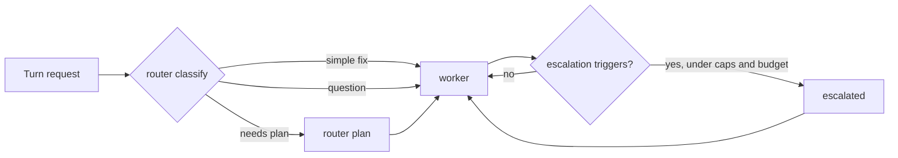

# Model router

The model router selects **which model role** and **which SKU** runs each inference call. It implements the product thesis: **cheap by default, expensive only with evidence**.

It also adapts the loop to **what the bound model can do**. thee runs anything from an 8B open model to a frontier model, so the tool protocol, edit format, context budget, and batching are read from the model's **capability profile** instead of being hard-coded for one class of model. OpenCode is the counter-example: its loop assumes frontier-grade tool calling and a large window, and degrades badly on small models.

## Roles

| Role | Typical SKU tier | Used for |
|------|------------------|----------|
| **router** | Smallest fast model (e.g. 8B class) | Task classification, plan sketch, escalate yes/no |
| **worker** | Mid coder model (e.g. Qwen3-Coder, Llama 3.3 70B) | Tool calls, patches, most turns |
| **escalated** | Stronger MoE / reasoning SKU, or a frontier model | Repeated verifier failure, ambiguous refactors |
| **summarizer** | Same as router or worker | Context compaction summaries only |

Roles map to entries in **`models.yaml`** (pinned IDs, rates, capabilities, `replaced_by`). Each role’s `provider` must be one the user has configured (BYOK)—the router does not assume a built-in key. A single frontier model may fill every role; the router then skips classification calls that would cost more than they save.

## Capability profile

Each model entry carries capability fields (schema in [providers.md](./providers.md#manifest-modelsyaml)). The router and context engine read them:

| Field | Values | Drives |
|-------|--------|--------|
| `context_window`, `max_output_tokens` | ints | Turn budget, compaction threshold |
| `served_context` | int, measured | The window the endpoint actually honors, when smaller than `context_window` (see [Local and self-hosted servers](./providers.md#local-and-self-hosted-servers)). Budgets use the smaller of the two. |
| `tool_protocol` | `native` · `two_step` · `fenced` | How tools are offered and parsed ([tools/README.md](./tools/README.md#tool-calling-protocols)) |
| `structured_output` | `json_schema` · `grammar` · `json_object` · `none` | Whether tool-call output is constrained at decode time ([Constrained decoding](./tools/README.md#constrained-decoding)) |
| `text_tool_dialect` | `none` · `hermes` · `qwen_xml` · `json_block` · `auto` | Which in-text tool-call shapes the salvage parser looks for ([Salvage before repair](./tools/README.md#salvage-before-repair)) |
| `parallel_tool_calls` | bool | Whether several calls per reply are accepted |
| `edit_format` | `udiff` · `search_replace` | Which `patch` schema the model sees ([patch](./tools/patch.md)) |
| `vision` | bool | Whether `browser` screenshots are sent as images |
| `reasoning` | `none` · `tokens` · `effort` | Reasoning params sent; reasoning tokens metered |
| `reasoning_history` | `strip` · `keep` · `keep_signed` | What happens to prior reasoning in later requests ([Reasoning content](./providers.md#reasoning-content)) |
| `prompt_variant` | `compact` · `standard` | Which system prompt and tool catalog wording the model gets ([Prompt variants](./context-engine.md#prompt-variants)) |
| `sampling` | `temperature`, `top_p`, `top_k`, `min_p`, `repetition_penalty`, `stop` | Per-model decoding settings; vendor-recommended values for the family |
| `tokenizer` | e.g. `o200k`, `hf:Qwen/Qwen3-Coder`, `approx` | Pre-call token estimation |
| `prompt_cache` | `auto` · `key` · `explicit` · `none` | Whether `prompt_cache_key` / cache markers are sent |
| `action_space` | `tools` · `bash` | Tool surface (see below) |

Unknown models get conservative defaults: `two_step`, `structured_output: none`, `text_tool_dialect: auto`, `search_replace`, `prompt_variant: compact`, `reasoning_history: strip`, no parallel calls, no vision, 32k context, temperature 0.2. Conservative means a small model works out of the box; a strong model on defaults works too, just with more model calls than it needs.

### Probe

`thee models probe <id>` calibrates a model against its real endpoint and writes a suggested profile to the user's catalog, so a new model can be tuned without a release. It runs, in order:

1. **Served context.** Sends a prompt with a marker near the start, at increasing lengths, and asks for the marker back. The largest length that round-trips is `served_context`. This catches local servers that silently truncate.
2. **Structured output.** Sends one request with `response_format: json_schema`, then one with a grammar where the provider supports it. Whichever is accepted and obeyed sets `structured_output`.
3. **Tool protocols.** A few scripted tool calls in each protocol. Records parse rate, which in-text dialect appeared when native calling failed, and calls per tool.
4. **Edit formats.** One edit in each format against a fixture file. Records which ladder step applied.
5. **Reasoning.** Checks whether the reply carries `reasoning_content`, `<think>` tags, or reasoning items, and whether a follow-up with prior reasoning stripped still works.

The probe picks the cheapest settings that cleared a pass threshold on every step (for example, `native` only if its parse rate matched `two_step`). Results carry the date and endpoint so a stale profile is visible.

## Task classification

The router classifies each new goal with one small structured call:

```json
{ "task_type": "change", "plan": "auto", "confidence": 0.82, "tags": ["test-fix"] }
```

- `task_type`: `change` or `question` ([session-director.md](./session-director.md#task-types)).
- `plan`: whether to enter `planning`.
- `confidence`: low confidence is an escalation trigger.

When router and worker are the same model, classification is folded into the worker's first turn.

## Routing flow



## Escalation triggers

Escalate **worker → escalated** when any:

- Verifier failed **N** times in a row on the same goal and model (default `escalate_after_verify_fails = 2`).
- Router confidence low (structured JSON from router model).
- User command `/escalate` or config `always_escalate_for: [security, migration]`.
- Tool rounds reach 60% of `max_tool_rounds` without verifier progress.
- Two consecutive malformed tool calls after a repair turn. A call the salvage parser recovers is not malformed.
- The loop detector fires a second time on the same goal after its nudge ([session-director.md](./session-director.md#loop-detection)).

Escalation is allowed only while `escalation_generation < max_escalations` (default 1) **and** the estimated cost of continuing on the escalated model fits the remaining dollar budget. Otherwise the trigger is recorded and the session director applies its caps, which end in `failed` rather than looping. See [session-director.md](./session-director.md#caps-and-budgets).

On escalation, the escalated model inherits the compacted context, not the raw transcript. If its profile allows (`tool_protocol: native`, `parallel_tool_calls: true`), it may batch calls.

De-escalate: after successful verify, next **new user goal** starts at worker.

## Provider selection

Per role in manifest:

```yaml
roles:
  worker:
    provider: deepinfra
    model: Qwen/Qwen3-Coder-480B-A35B-Instruct-Turbo
    service_tier: standard   # or flex for batch jobs
  router:
    provider: deepinfra
    model: meta-llama/Meta-Llama-3.1-8B-Instruct-Turbo
```

**Failover:** `fail_fast` on primary → secondary provider entry (e.g. OpenRouter route) — see [providers.md](./providers.md). The failover model's capability profile replaces the primary's for that call. Prior reasoning is re-shaped for the new adapter (usually stripped), because reasoning blocks are not portable across providers.

## Action space per tier

From harness design research ([arXiv:2609.20804](https://arxiv.org/abs/2609.20804)):

| Model tier | Tool surface |
|------------|--------------|
| Weak / small | Full **predefined tools** only |
| Strong bash | Optional **bash-only** mode for terminal-heavy tasks (fewer tool tokens) |

Manifest flag: `action_space: tools | bash` per role. `bash` requires the `full` tier.

## Catalog overrides (BYOK)

Ante-style **`catalog.json`** (user-level): register providers (base URL + `api_key_env`), add models and their capability profiles, or override shipped defaults—no vendor lock-in. See [providers.md](./providers.md#bring-your-own-keys-byok).

## Cost accounting

Router passes **list price** from manifest to observability on each call. Provider usage reports `prompt_tokens` including cached tokens, and `completion_tokens` including reasoning tokens, so:

```text
uncached_in = input_tokens - cached_tokens - cache_write_tokens
cost_usd = ( uncached_in        * rate_in
           + cached_tokens      * rate_cached
           + cache_write_tokens * rate_cache_write   # explicit-cache providers; rate_in when unset
           + output_tokens      * rate_out ) / 1e6
```

- `reasoning_tokens` (from `completion_tokens_details`) is recorded separately for display but already sits inside `output_tokens`; it is not added twice. A model with `reasoning_per_m` set prices that slice at its own rate instead.
- When the provider returns its own cost (OpenRouter `usage.cost`, a LiteLLM-style gateway, or our API), observability records both and the provider figure wins for display.
- Missing rates show `$—`; token counts are still recorded.

Display **cumulative session cost** in CLI status line.

## Out of scope

- ML-based tier routing (OpenSquilla-style). Evidence triggers are enough and are explainable.
- Multi-model debate (h5i).

## Related

- [providers.md](./providers.md) — manifest and capability schema  
- [session-director.md](./session-director.md) — `escalating` state, caps  
- [verifier.md](./verifier.md) — failure signals  
- [context-engine.md](./context-engine.md) — budgets from `context_window`
