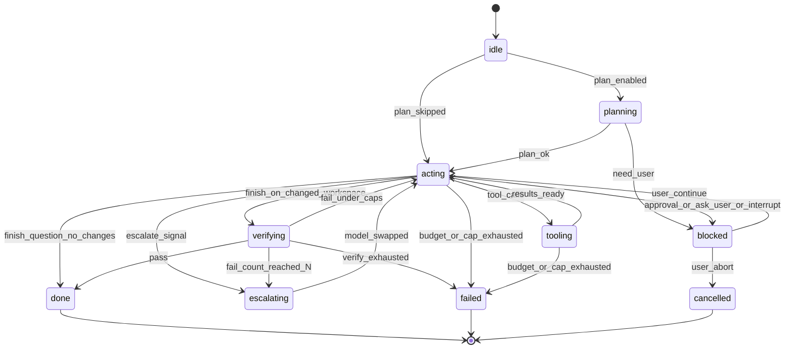

# Session director

The session director is the **orchestrator** of a single agent run. It does not call models directly; it drives the other components through a explicit **state machine** and owns **checkpoints**, **budgets**, **caps**, and **user interaction** boundaries.

## Responsibilities

- Start, resume, and fork sessions (local session id, workspace root).
- Check **workspace trust** before honoring project config, hooks, skills, or the verify command. See [security-and-policy.md](./security-and-policy.md#workspace-trust).
- Enforce **token, dollar, wall-clock, and round budgets**; end the session as `failed` when one is exhausted. Budgets never produce `done`.
- Optional **planning phase** before destructive edits.
- Coordinate one **act → tool → observe** cycle per model turn.
- Invoke **verifier** before allowing `finish` whenever the session changed files.
- Request **escalation** from the model router when policy says so, up to `max_escalations`.
- Handle **interrupts** and **mid-run user messages**.
- Emit lifecycle events to **observability** (every state change).

## Task types

The router classifies each goal (see [model-router.md](./model-router.md#task-classification)):

| Type | Example | Verify rule |
|------|---------|-------------|
| `change` | "fix the failing test", "add a flag" | `finish` requires a verifier pass |
| `question` | "where is X configured?", "explain this function" | `finish` allowed without verify; the answer must cite `path:line` |

The rule that actually gates `finish` is **"did the session change the workspace?"**, not the label. A `question` session that applies a patch becomes a `change` session and must verify. A misclassified `change` that never edits a file cannot fake a pass, because there is nothing to pass.

## State machine

| State | Enter when | Exit when |
|-------|------------|-----------|
| `idle` | Session created | User submits goal |
| `planning` | Plan mode on / complex goal | Plan approved or skipped → `acting` |
| `acting` | Model turn in progress | Turn complete (text or tools) |
| `tooling` | Model emitted tool calls | All tools resolved or error |
| `verifying` | Agent calls `finish` on a changed workspace (or `[verify] on = "patch"`) | Pass → `done`; fail → `acting` or `escalating` or `failed` per caps |
| `escalating` | Router triggered upscale | New worker model bound → `acting` |
| `blocked` | Needs human: approval, clarification (`ask_user`), plan approval, or interrupt | User input → `acting`; double interrupt → `cancelled` |
| `done` | `finish` accepted (verifier passed, or `question` session with no changes) | — terminal success |
| `failed` | Harness gives up: budget, caps, unrecoverable parse streak, headless needs-human | — terminal non-success |
| `cancelled` | User aborts | — terminal non-success |

`blocked` is resumable. `done`, `failed`, and `cancelled` are terminal for the **goal**; in an interactive session the user can type a new goal, which starts a fresh goal (counters reset, worker model restored) inside the same session and trace.



Any state can move to `failed` when a budget runs out, and to `cancelled` on a double interrupt. The diagram shows the common edges.

## Caps and budgets

Configured in `thee.toml` under `[session]`. Defaults are tuned for small workers, which burn budget on retry loops; one structured failure beats another full-context resend.

```toml
[session]
token_budget = 2_000_000        # input + output, all roles
cost_budget_usd = 2.00          # optional; see "Dollar budget"
wall_clock_minutes = 45
max_tool_rounds = 40            # per goal
max_verify_attempts = 6         # full verify runs per goal, across all models
max_escalations = 1             # per goal
escalate_after_verify_fails = 2 # consecutive, same model (router trigger N)
```

Order of operations when things go wrong:

1. **Verify failure.** Return the failure bundle and go back to `acting`. After `escalate_after_verify_fails` consecutive failures on the same model, escalate if `max_escalations` allows. When `max_verify_attempts` is reached, or the escalated model also fails N times in a row with no escalations left, end as `failed` (`verify_exhausted`), attaching the last failure bundle.
2. **Tool rounds.** At 60% of `max_tool_rounds` with no verify progress, the router treats it as an escalation trigger. At `max_tool_rounds`, end as `failed` (`tool_rounds_exhausted`).
3. **Malformed tool calls.** Salvage first ([tools/README.md](./tools/README.md#salvage-before-repair)); a salvaged call is not a failure. Otherwise one repair turn. A second consecutive failure escalates. If the escalated model also produces two consecutive malformed calls, end as `failed` (`tool_parse_exhausted`).
4. **Loops.** See [Loop detection](#loop-detection). Nudge once, then escalate, then end as `failed` (`loop_detected`).
5. **Budgets.** The director checks before each model call: estimated input plus `max_tokens` (and its estimated $) must fit what remains. If not, it compacts once; if it still does not fit, end as `failed` (`budget_exhausted`, with which budget). An escalation that would not fit the remaining dollar budget is skipped, not attempted.

### Loop detection

Small models get stuck in ways that look like work: the same call again, the same file re-read, the same failing patch resent. `max_tool_rounds` eventually stops this, but only after spending most of the budget. The director watches for it directly, using data the trace already records (`args_hash`, file hashes, verify failure signatures):

| Pattern | Fires when (defaults) |
|---------|-----------------------|
| Repeated call | Same tool and `args_hash` 3 times in the last 8 rounds, with no file change between them |
| Re-reading | Same file and overlapping line range read 3 times with no change to that file |
| Patch thrash | A patch rejected at the same hunk twice, or a patch that reverts the previous one |
| Verify stall | Two consecutive verify runs with the same failure signature (same failing tests, same first error line) and a non-empty diff between them |
| Oscillation | Workspace tree hash returns to a value seen earlier in the goal |
| No-op turns | 3 consecutive turns with no tool call and no `finish` |

Response, in order:

1. **Nudge.** One message in the tail naming what repeated ("you have read `src/a.go` 120–180 three times; it has not changed") and the obvious next options. Repeats are also answered from cache, without re-running the tool, so they cost no tool tokens.
2. **Escalate** if the same detector fires again on this goal and `max_escalations` allows.
3. **Fail** with `loop_detected` if it fires on the escalated model, or no escalation is left.

Thresholds are in `[session.loop]`. Each firing is a `loop.detected` event so per-model loop rates show up in the eval ([observability.md](./observability.md#derived-metrics)).

### Dollar budget

`cost_budget_usd` (session) and optional `goal_cost_budget_usd` are enforced from manifest rates. If any active role has no rates and a dollar budget is set, the director warns at start and enforces the token budget only for that role. The CLI warns at 80% of either budget.

## Headless behavior

`thee run -p` has no human, so anything that would be `blocked` becomes a terminal outcome.

| Situation | Headless outcome |
|-----------|------------------|
| Tool needs approval (e.g. shell in `edit` tier) | Tool denied; model told it is unavailable. Not terminal. |
| Plan approval required by policy | `failed` (`approval_required`) |
| `ask_user` | Tool result tells the model no user is present: pick the safest assumption and state it in the `finish` summary. Not terminal. |
| Workspace untrusted and a verify command is needed | `failed` before the first model call (`workspace_untrusted`) |
| Strict verify mode and no verify command detected | `failed` before the first model call (`no_verify_command`) |

### Exit codes

| Code | Meaning |
|------|---------|
| `0` | `done` |
| `1` | `failed` — verify, budget, or cap exhausted |
| `2` | `failed` — needed a human (`approval_required`) |
| `3` | Setup error — no provider key, untrusted workspace, no verify command, bad config |
| `130` | `cancelled` (SIGINT) |

`session.end` in JSONL always carries `outcome`, `reason`, `verify_attempts`, `escalation_generation`, `tool_rounds`, totals, and `workspace_changed`. That is the same shape `thee eval` and benchmark runners consume. See [observability.md](./observability.md).

## Workspace state at start

- **Git repo, clean tree.** Record `HEAD` as the session base.
- **Git repo, dirty tree.** Allowed. The director snapshots the current tree (including untracked, non-ignored files) into a shadow ref `refs/thee/sessions/<id>/base` without touching the user's index, branch, or stash. The user's uncommitted work is never stashed or reset. Interactive mode prints one line noting the dirty files.
- **Not a git repo.** Allowed. Checkpoints fall back to file snapshots (see [checkpoint](./tools/checkpoint.md)). Verify baselines still work.

The diff the user reviews at the end is always `base → current`, so pre-existing edits are not attributed to the agent.

## Interrupts and steering

| Input | While | Effect |
|-------|-------|--------|
| **Ctrl-C** once | Model streaming | Abort the stream. Discard partial tool arguments. Go to `blocked` (`interrupt`). |
| **Ctrl-C** once | Tool running | Kill the tool's process group (SIGTERM, then SIGKILL after 3s). Record the tool result as `cancelled`. Go to `blocked`. |
| **Ctrl-C** twice within 2s, or `/abort` | Any | End the goal as `cancelled`. |
| Typed message | `acting` / `tooling` | Queued. Injected as a user message at the next turn boundary, after the in-flight tool returns. |
| Typed message | `blocked` | Resumes `acting` with that message. |

File writes are atomic (temp file + rename), so an interrupt never leaves a half-written file. A patch batch interrupted mid-way reports which files were applied.

## Planning module

Planning is **optional** and **cheap-model-first**:

- Output: markdown plan file `plans/<session-id>.md` (transparent, diffable).
- Inputs: user goal + context engine **summary** of repo (not full tree).
- Modes:
  - **Auto** — skip planning for small goals (router classifies).
  - **Always** — team policy.
  - **Approve** — pause in `blocked` until user accepts plan.

Influences: Plandex (plan-first), Keen Code (saved design docs), Cline plan mode.

## Checkpoints & resume

- After each **successful verifier run**, before each escalation, and every N turns, persist a checkpoint:
  - Session state, compaction snapshot id, shadow git ref (see [checkpoint](./tools/checkpoint.md)).
- Resume reloads checkpoint + tail of JSONL trace. A trace or checkpoint with a newer major `schema_version` is refused with a clear message; older minor versions load.
- A `failed` goal keeps its changes and a checkpoint, so the user can inspect, resume with guidance, or restore the base.
- **Undo:** revert the last applied patch batch — inspired by Codewhale `/undo`.

## Turn contract (internal API)

Each turn the director passes to the model router:

```text
TurnRequest {
  session_id,
  goal_id,
  task_type,               // change | question
  state,
  user_message?,           // optional on continuation turns
  tool_results?,           // from prior tooling state
  budget_remaining_tokens,
  budget_remaining_usd?,
  escalation_generation,   // escalations so far this goal; capped by max_escalations
  verify_attempts,
}
```

## Surfaces

| Surface | Behavior |
|---------|----------|
| **Interactive CLI** | Full state machine, approvals, interrupts — layout and commands in [cli.md](./cli.md) |
| **Headless `run -p`** | Model `shell` denied unless `--yolo`. Verifier runs as a harness subprocess when the workspace is trusted (`--trust` or trusted list). Exit code per table above. |
| **`serve`** | Same director; JSONL protocol over stdio/WebSocket (Ante-style), for IDEs and other front ends — protocol TBD; stub in v1 per [cli.md](./cli.md) |

## Out of scope

- Multi-agent delegation graphs (orchestrators like Orca). Delegation is one level of [subagent](./tools/subagent.md), read-only or writing.
- Cross-session memory sync.

## Open questions

- Should forking a session be a user-facing command, or only the mechanism behind subagents?

## Related

- [context-engine.md](./context-engine.md) — what each turn sends to the model  
- [model-router.md](./model-router.md) — escalation triggers  
- [verifier.md](./verifier.md) — gate before `done`  
- [security-and-policy.md](./security-and-policy.md) — trust, approvals
