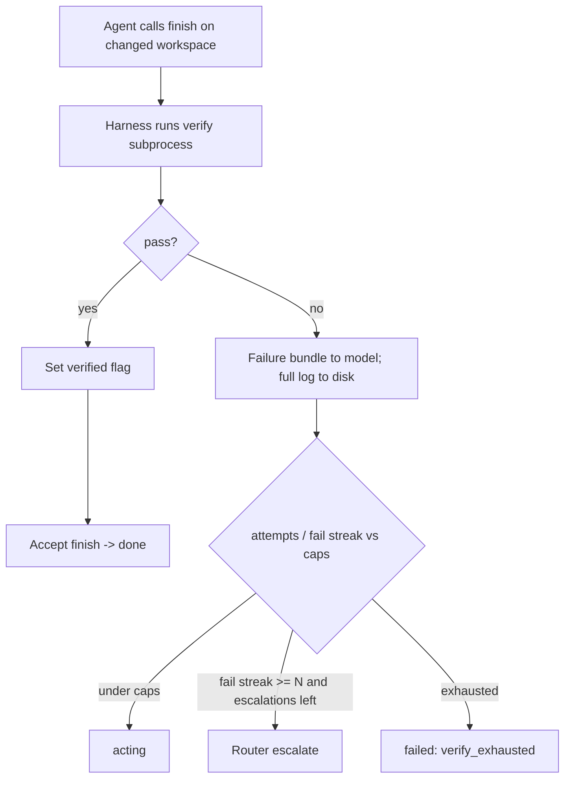

# Verifier

The verifier is the **quality gate** between “the model said it’s done” and **session `done`**. It encodes engineering reality: **green tests / lint** matter more than confident prose.

Verification is run **by the harness**, not by the model. The harness spawns the configured command as its own subprocess and hands the model a short, failure-focused result. This is what benchmarks and repair loops use, and it means the worker only needs reliable `read` / `patch` calls, not reliable shell use plus "I'm done" judgment. Model [`shell`](./tools/shell.md) is a separate, optional debug tool in the `full` tier; official pass/fail never depends on it.

## Responsibilities

- Run the configured **verify command** when the agent calls `finish` on a changed workspace (and optionally after patch batches).
- Run a **baseline** before the first patch so pre-existing failures are not blamed on the agent.
- Return structured **pass / fail** + a small failure bundle to the session director and model; keep full logs on disk.
- Flag **verify gaming** (edits to tests or verify config).
- Feed **failure signals** to the model router for escalation.
- Block `finish` until pass (or explicit user override).

## Trust

The verify command comes from the repo (`thee.toml`, `package.json` scripts, `Makefile`). Running it executes repo code as the user, outside the model's permission tier. So verify execution is gated by **workspace trust**, not by tier:

- **Trusted workspace:** run the resolved command.
- **Untrusted, interactive:** show the resolved command once and ask. Approval is remembered per workspace until the command string changes.
- **Untrusted, headless:** setup error (`workspace_untrusted`, exit 3) unless `--trust`, a user-level `[verify] command`, or `--verify-cmd` is given.

See [security-and-policy.md](./security-and-policy.md#workspace-trust).

## Command resolution

Project detection order (ADR-005):

1. CLI `--verify-cmd`
2. User or project `thee.toml` → `[verify] command = "..."`
3. `package.json` → `npm test` / `pnpm test` / `yarn test` (by lockfile)
4. `Makefile` → `make test` if target exists
5. Python → `pytest -q` if pytest config present
6. Go → `go test ./...`
7. Rust → `cargo test`

If nothing resolves:

- **strict** mode: interactive asks the user for a command (or to switch mode); headless is a setup error (`no_verify_command`, exit 3).
- `git diff --stat` is **not** a pass under strict. It is only an informational check under `manual` or `off`.

Always optional: `[verify] lint = "..."` (eslint, ruff, etc.).

## Subprocess policy

Verify is its own subprocess policy, not a special case of `shell`.

| Setting | Default | Notes |
|---------|---------|-------|
| `timeout` | 10 min | Per run. Override per project. |
| `lint_timeout` | 2 min | For `[verify] lint`. |
| Environment | `CI=1`, `TERM=dumb`, no TTY, stdin closed | Stops watch modes and interactive prompts (jest/vitest watch, pagers). Provider API keys are scrubbed from the env. |
| Kill | Whole process group; SIGTERM, SIGKILL after 5s | On timeout or interrupt. |
| Sandbox | Same as `shell` when enabled | See [security-and-policy.md](./security-and-policy.md#sandboxing). |
| Full log | `.thee/sessions/<id>/verify-<n>.log` | Stdout + stderr, redacted with the trace redaction patterns. |

The verify timeout counts against the session wall-clock budget, so `max_verify_attempts × timeout` cannot silently turn into an hour.

## Cadence

```toml
[verify]
command = "pytest -q"
lint = "ruff check ."
on = "finish"            # finish | patch
filter_command = "pytest -q {filter}"   # enables the `test` tool
test_edits = "flag"      # allow | flag | approve | deny
baseline = true
```

- `on = "finish"` (default): full verify runs when the agent calls `finish` on a changed workspace.
- `on = "patch"`: full verify after each patch batch. Only sensible for fast suites.
- `lint`, when set, runs after every patch batch regardless. It is fast feedback, not the gate (except in `lint-only` mode).
- The model can run a **targeted subset** with the [`test`](./tools/test.md) tool between edits. Targeted runs never set the verified flag; only a full run does.

## Baseline

When `baseline = true`, the harness runs the full verify command once **before the first patch** (in parallel with the first model turn, so it costs no wall-clock in the common case). The result is cached by tree hash.

- Baseline passes: normal strict semantics.
- Baseline fails: the model is told which failures pre-exist (from the parsed bundle). Strict pass still requires exit 0, because that is the only signal every framework provides. Teams with a known-red suite set `pass = "no_new_failures"`, which requires a framework the parser understands (pytest, go test, jest/vitest, cargo); otherwise it falls back to exit 0.
- Where the parser can count tests, a drop in the number of tests run versus baseline is reported as a failure reason (`tests_removed`), even if exit is 0.

## Verify gaming

Strict verify invites passing by editing or deleting tests. Protected paths default to:

```text
**/test/** **/tests/** **/__tests__/** **/spec/**
*_test.go *.test.* *.spec.* test_*.py *_test.py conftest.py
jest.config.* vitest.config.* pytest.ini tox.ini .github/workflows/**
thee.toml (the [verify] table)
```

| `test_edits` | Adding new test files | Modifying or deleting existing protected files |
|--------------|-----------------------|-----------------------------------------------|
| `allow` | allowed | allowed |
| `flag` (default) | allowed | allowed, recorded, shown in the `finish` summary and `session.end.protected_files_changed` |
| `approve` | allowed | needs user approval (headless: denied) |
| `deny` | allowed | denied |

Editing the `[verify]` table itself always needs approval (headless: denied). Benchmark runners should use `deny`.

## Verify flow



Caps are owned by the [session director](./session-director.md#caps-and-budgets).

## Failure bundle (to model)

The model gets a small, failure-focused bundle, not a blind tail. Aider-style: roughly the first 50 lines of failing tests, assertions, and `file:line` hints.

```text
verify_result {
  passed: false,
  command: "npm test",
  exit_code: 1,
  duration_ms: 48210,
  failures: [
    { test: "parses empty input", location: "src/foo.test.ts:42", message: "expected [] got null" }
  ],
  excerpt: "... up to model_max_lines / model_max_bytes of the most relevant output ...",
  baseline: "pass",            // pass | fail | unknown
  log_path: ".thee/sessions/<id>/verify-3.log"
}
```

| Setting | Default |
|---------|---------|
| `model_max_lines` | 50 |
| `model_max_bytes` | 4 KiB |

Extraction uses **framework-specific parsers** (pytest, go test, jest/vitest, cargo) when the command is recognized; they fill `failures[]` precisely. Anything else falls back to a **heuristic**: lines matching `FAIL`, `Error`, `assert`, `panic`, `Traceback`, and `path:line` patterns, with surrounding context, then the last lines. The model can `read` the log path for more.

The failure signature (failing test ids, or the first error line when there are none) is recorded so the director can detect a verify stall ([session-director.md](./session-director.md#loop-detection)).

`verify.run` in JSONL records command, exit code, duration, log path, and failure count — not the log body in strict ZDR export.

## Modes

| Mode | What `done` requires |
|------|----------------------|
| **strict** (default) | Full verify command exit 0 (or `no_new_failures` when configured) |
| **lint-only** | Lint command exit 0 |
| **manual** | User types `/verify` or approves the diff |
| **off** | Nothing. `session.end.verified = false`. Dangerous; CI-only use |

`question` sessions that did not change the workspace finish without verify in every mode. See [session-director.md](./session-director.md#task-types).

## Relationship to `finish`

- `finish` handler checks: workspace unchanged, or `session.verified == true` for the current tree hash.
- An edit after a pass clears the verified flag.
- If agent calls `finish` before a pass, the harness runs verify; `finish` succeeds only if it passes.

## Influences

- zeroshot (independent validators), SWE-agent (test-driven loops), Aider (test output in the repair turn), opencode-harness `finish` event, MartinLoop (verifier passes as budgeted steps).

## Related

- [session-director.md](./session-director.md) — `verifying` state, caps  
- [model-router.md](./model-router.md) — escalation on repeated fail  
- [tool-runtime.md](./tool-runtime.md) — patch before verify  
- [tools/test.md](./tools/test.md) — targeted test runs
