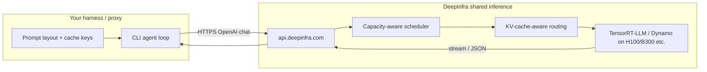

# DeepInfra — research brief

**Purpose:** Evaluate [DeepInfra](https://deepinfra.com/) as the primary **inference supplier** for a frugal engineering harness (CLI + optional proxy), including whether anything is materially cheaper, how the platform works operationally, and what constraints matter for **serverless / stateless / zero-retention** product design.

**Status:** Desk research from official docs and pricing (Oct 2026). Re-verify list prices before committing volume or margin models.

---

## 1. Executive summary

| Question | Answer |
|----------|--------|
| **What is it?** | Managed **AI inference cloud**: 200+ models, OpenAI-compatible chat/embeddings/images, plus dedicated GPU deploys, GPU rental, sandboxes, and hosted agent VMs. |
| **Core value prop** | **Pay-per-token** shared inference with no idle GPU on the default path; aggressive pricing on **open-weight** models; large catalog; fast time-to-new-model. |
| **Is it the cheapest?** | For many **identical open-weight SKUs**, DeepInfra is often **among the lowest** (frequently cited as lowest mainstream host in independent comparisons). **Novita** sometimes undercuts on specific models (~5–15%). **Groq/Cerebras** optimize **latency**, not $/token. **OpenRouter** is passthrough + ~5.5% credit fee, but can route to the cheapest endpoint. |
| **Serverless?** | **Yes** for default API: you call HTTPS; they schedule on shared fleet (queue, autoscale). You do **not** manage pods. |
| **Stateless for you?** | **Yes** at the API boundary: each request is independent unless **you** send conversation history or use **prompt cache keys / retention**. |
| **Good fit for muxon?** | **Strong** as default upstream for **cheap coder models** + **prompt caching** + **flex tier** for background jobs + **fail_fast** multi-provider failover. **Weak** as a standalone “wholesale” business (thin margin, no public reseller tier). |

---

## 2. Product surface (what you can buy)

### 2.1 Shared inference (default path)

- **Base URL (OpenAI-compatible):** `https://api.deepinfra.com/v1/openai`
- **Auth:** `Authorization: Bearer $DEEPINFRA_API_KEY`
- **Also:** Native REST at `https://api.deepinfra.com/v1/inference/{model_name}` for non-chat modalities.
- **Modalities (docs index):** Chat, streaming, tool calling, structured outputs, vision/OCR, embeddings, rerankers, image/video, speech (Whisper, TTS), batch jobs, Anthropic Messages API route, OpenAI Responses API route.

**Mental model:** You are a **client** of a **multi-tenant inference scheduler**. DeepInfra owns GPUs, kernels (TensorRT-LLM, NVIDIA Dynamo, NVFP4 quant), routing, and queuing.

### 2.2 Service tiers (per-request scheduling)

From [pricing](https://deepinfra.com/pricing) and [chat overview](https://docs.deepinfra.com/chat/overview):

| Tier | Multiplier | Behavior |
|------|------------|----------|
| **Standard** | 1.0× | Default; may queue at peak |
| **Priority** | 1.5× | Ahead of standard traffic; faster TTFT under load |
| **Flex** | 0.8× | Cheaper; slower; may wait up to **10 minutes** or get **429** |

**Harness implication:** Route **interactive CLI turns** → standard/priority; **eval batches, enrichment, retryable tasks** → flex.

### 2.3 Queue behavior and failover

- Default: requests **wait in queue** when model is busy.
- **`fail_fast: true`:** Immediate **429** with `engine_overloaded` — **not billed** (no inference). Built for **failover to another provider**.
- **`fail_fast` + `priority`:** fail_fast wins (no priority queue wait).

### 2.4 Prompt caching (cost + latency)

From [prompt caching](https://docs.deepinfra.com/chat/prompt-caching):

- **Automatic** prefix KV reuse when the **beginning** of the prompt matches recent requests (per model, per account).
- Billing: `usage.prompt_tokens_details.cached_tokens` in the response.
- **`prompt_cache_key`:** Session-scoped key (e.g. `userId-sessionId`) to improve hits when formatting differs slightly.
- **Prompt cache retention** (separate doc): optional **5 min / 1 hour** retention windows with cache-write premium — useful for stable system prompts across a coding session.

**Harness implication:** This is **structural** to your economics:

1. **Stable system prompt + tool schemas** at the top of every request.
2. **Append-only conversation** (don’t reshuffle messages).
3. **No timestamps/UUIDs in the cached prefix.**
4. **Separate “repo index” block** that changes rarely vs per-turn user text.

### 2.5 Tool calling (agent loop)

From [tool calling](https://docs.deepinfra.com/chat/tool-calling):

- OpenAI-style `tools` / `tool_choice`; single and parallel tool calls; streaming supported; nested calls not supported.
- Tool definitions count as **input tokens**.
- Docs emphasize **tool-call accuracy** as a product focus (relevant for smaller open models).

**Harness implication:** Prefer **few, high-signal tools** (grep, read slice, apply_patch, run_test) — aligns with DeepInfra’s own guidance and reduces slop.

### 2.6 Batch API

From [batch introduction](https://docs.deepinfra.com/batch/introduction):

- OpenAI-compatible JSONL workflow; results within **24h**; **20% off** real-time pricing.
- Does **not** consume real-time concurrent quota.
- Limits: 50k lines/file, 200MB file, 100 concurrent batches per user.

**Harness implication:** Nightly evals, embedding corpora, regression harness runs.

### 2.7 Private / dedicated deployments

From [private models overview](https://docs.deepinfra.com/private-models/overview):

- **Your weights** on **dedicated** A100/H100/H200/B200/B300; **GPU-hour** billing (not per token).
- Autoscaling, private endpoint, isolation for compliance.
- Example published GPU rates (pricing page): A100 ~$0.89/hr, H100 ~$2.20/hr, B300 ~$4.89/hr (verify live).

**When to use:** Customer requires **no shared tenancy**, custom LoRA, or predictable latency — not the default for a pay-as-you-go CLI product.

### 2.8 GPU instances & clusters

- Rent B200/B300 with SSH for training/custom stacks.
- Contact for large clusters (dedicated@deepinfra.com).

### 2.9 Sandboxes (agent execution substrate)

From [sandboxes overview](https://docs.deepinfra.com/sandboxes/overview):

- **Ephemeral Linux microVMs** (Kata/QEMU); API/SDK to exec, read/write **`/workspace` only** (persistent across stop/start).
- Per-second billing while running; idle timeout; 24h max continuous run; 7-day retention after stop.
- **Outbound internet yes; inbound no**; isolation from other sandboxes and DeepInfra internal net.
- Up to **25 active** sandboxes per account.

**Harness implication:** Optional **remote command execution** without storing customer code on your proxy — pair with ZDR narrative. Local CLI can still run tools on the developer machine by default.

### 2.10 Hosted agents

Docs list managed **OpenClaw**, **Hermes-Agent**, etc., billed hourly, pre-wired to DeepInfra inference — relevant as **competitive reference**, not core to muxon unless you offer a hosted tier later.

---

## 3. Architecture — how it works (engineering view)

### 3.1 “Serverless”

- **You:** HTTP request/response (or stream); no cluster management.
- **They:** Autoscale model replicas; per-model **200 concurrent requests** default ([rate limits](https://docs.deepinfra.com/account/rate-limits)).
- **Throughput** scales with **request duration** (200 concurrent × short requests = high RPM).

### 3.2 “Stateless”

- **API is stateless:** No server-side chat session unless you use features that imply storage (batch files, sandbox `/workspace`, private deploy state).
- **Conversation state is client-owned:** Every turn you resend `messages[]` (or equivalent). Your harness **owns** compaction, summarization, and what gets resent — this is where token economics are won or lost.

### 3.3 Reliability patterns for a proxy layer

If you add Railway/serverless proxy:

| Pattern | Use |
|---------|-----|
| **fail_fast + retry** on alternate model or provider | Avoid tail latency in queue |
| **flex tier** | Background jobs |
| **scoped JWT** ([auth docs](https://docs.deepinfra.com/account/authentication)) | Per-tenant keys with limited scope |
| **spending limits / per-key limits** | Team product guardrails |
| **OpenRouter as secondary** | Same model family, different host |

---

## 4. Data privacy & retention (critical for ZDR story)

From [data privacy](https://docs.deepinfra.com/account/data-privacy):

| Claim | Detail |
|-------|--------|
| **Inference payloads** | Not stored on disk; held **in memory** during processing; outputs deleted after delivery |
| **Training** | No training on API data **except** when you call **Google** or **Anthropic** models (their policies apply) |
| **Sharing** | No third parties **except** routing to Google/Anthropic for those models |
| **Logs** | **Not** full request content by default; metadata (request ID, cost, sampling params). Reserved right to log small portion for security/debug |
| **Bulk/batch** | May store encrypted on disk for a **short** period until results delivered |
| **Image gen** | Outputs may be stored briefly for demo/access |

**Trust center:** SOC 2 / ISO 27001 cited on privacy policy; see [trust.deepinfra.com](https://trust.deepinfra.com/resources).

**Product guidance for muxon:**

- Prefer **open models on DeepInfra** for maximum alignment with “we don’t warehouse your code.”
- **Disclose** that closed models on the same API may forward to Google/Anthropic.
- Your proxy should **not** log bodies; aggregate **token counts + hashed session id** only.
- **Batch API** and **sandboxes** have different retention — document separately if used.

---

## 5. Pricing landscape (open-weight focus)

### 5.1 Representative DeepInfra token prices (check live catalog)

From [deepinfra.com/pricing](https://deepinfra.com/pricing) — **$/1M tokens**, illustrative SKUs for **engineering harness**:

| Model (examples) | Input | Output | Notes |
|------------------|-------|--------|-------|
| Meta-Llama-3.1-8B-Instruct-Turbo | $0.02 | $0.04 | Ultra-cheap router/summarizer |
| Mistral-Nemo-Instruct | $0.029 | $0.03 | Small, fast |
| Qwen3-32B | $0.08 | $0.28 | Strong cheap general |
| Llama-3.3-70B-Instruct-Turbo | $0.10 | $0.32 | Workhorse |
| Qwen3-Coder-480B-A35B-Instruct-Turbo | $0.30 (+ cached input ~$0.10) | $1.00 | Coding specialist |
| DeepSeek-V4-Flash | ~$0.06–0.09 (+ cache) | ~$0.18 | Long context MoE |
| DeepSeek-V3.2 | $0.26 (+ cache) | $0.38 | Strong reasoning/cost |
| NVIDIA-Nemotron-3-Super-120B | $0.085 | $0.40 | Agent-oriented OSS |
| Claude / Gemini on DeepInfra | $1–25+ in | Much higher out | Frontier; not “frugal default” |

**Cached input** is often **2–10× cheaper** than standard input on eligible models — treat as a **first-class** harness feature.

### 5.2 Stackable discounts

| Mechanism | Discount |
|-----------|----------|
| Flex tier | 0.8× |
| Batch API | 0.8× vs realtime |
| Prompt cache reads | Model-specific (see pricing column “cached”) |

Combined with harness token reduction, **3×+ vs “dump whole repo to Sonnet”** is plausible (see product thesis doc).

### 5.3 Competitor comparison (same weights, different host)

Independent comparisons (2026) consistently find:

| Provider | Positioning |
|----------|-------------|
| **DeepInfra** | Often **lowest $/token** on open models; huge catalog; also largest provider footprint on OpenRouter |
| **Novita** | Price competitor; sometimes **~5–15% below** DeepInfra on specific models; leaner ops |
| **Together / Fireworks / Baseten** | Often **list-price parity** with model makers; sell throughput, fine-tuning, enterprise |
| **Groq** | **Speed**; not cheapest on many SKUs |
| **Cerebras** | **Throughput** for streaming; premium pricing |
| **OpenRouter** | **Aggregator**; no inference markup; **5.5%** on card credits; sort by price per model |
| **DeepSeek direct API** | Occasionally wins on **off-peak** DeepSeek-native pricing |

**Practical rule:** For a **single-supplier** frugal harness, **DeepInfra is a defensible default**. For **production hardening**, implement **OpenRouter or second host** as failover, not as the only cost story.

### 5.4 Is anything “cheaper than DeepInfra”?

- **Yes, sometimes:** Novita and occasional **promotional / zero** SKUs (e.g. limited free models on Novita — verify terms).
- **Self-host:** Cheapest at **very high** sustained volume if you accept ops burden (vLLM on own GPUs).
- **Local GGUF:** $0 API cost; hardware + electricity; Ante-style harness (see harness doc).

**Not cheaper:** Running your own **Railway proxy** without token discipline — you add compute **and** still pay tokens.

---

## 6. Rate limits, billing, and ops

### 6.1 Rate limits

- **200 concurrent requests per model** per account (default).
- Increase via dashboard request.
- 429 when exceeded or when fleet is hot (retry with backoff).

### 6.2 Billing

- Card or prepay; invoiced accounts billed monthly; usage tiers with invoice thresholds ($20 → $10k+).
- Per-request cost API exists in docs (`Get Request Costs`).
- **Spending limits** available (pricing page FAQ).

### 6.3 Observability

- Logs/metrics APIs (metadata-oriented).
- Dashboard usage/token breakdown.

### 6.4 Model lifecycle

- Models API includes `deprecated`, `replaced_by` — **your product** should pin **curated model sets** and migration paths (customer fear of deprecation).

---

## 7. Integrations relevant to harnesses

Official integration docs include **Pi**, **Hermes Agent**, **LangChain**, **Vercel AI SDK**, **Claude Code** (via Anthropic-compatible route), **CrewAI** + sandboxes, **Microsoft Agent Framework**.

**DeepInfra explicitly positions** as provider with **most models on OpenRouter** — you can keep DeepInfra as primary and use OpenRouter for exotic models without separate contracts.

---

## 8. Suggested model tiers for muxon (initial)

| Role | Example DeepInfra models | Rationale |
|------|--------------------------|-----------|
| **Router / classifier** | Llama 3.1 8B, Mistral Nemo, Gemma 3 4B | Near-free intent + escalation decision |
| **Default coder** | Qwen3-Coder-480B-Turbo, Qwen3-32B, Llama 3.3 70B | Tool use + code quality balance |
| **Reasoning escalation** | DeepSeek V3.2 / R1, Nemotron Ultra | Only when tests fail or planner stuck |
| **Embeddings / RAG** | bge-m3, e5, Qwen embedding SKUs | Cheap retrieval instead of full-file paste |
| **Avoid as default** | Claude Opus, Kimi K3 on DI | Cost blows up product thesis |

Use **flex** for: embedding refresh, batch eval, doc generation.  
Use **priority** only for: paid team “interactive SLA” tier.

---

## 9. Risks and gaps

| Risk | Mitigation |
|------|------------|
| Thin resale margin | Charge for **harness + policy**, not tokens |
| Queue latency at peak | fail_fast + fallback provider; priority tier for teams |
| Tool-call quality on small models | Escalation + verifier pass (tests/linter) |
| Google/Anthropic routes break ZDR | Block or gate those models in “strict ZDR” mode |
| Catalog churn | Curated **model manifest** with version pins |
| 200 concurrent cap | Shard keys / enterprise limit increase / batch for offline |

---

## 10. References

- Docs index: https://docs.deepinfra.com/llms.txt  
- Pricing: https://deepinfra.com/pricing  
- Chat / tiers / fail_fast: https://docs.deepinfra.com/chat/overview  
- Prompt caching: https://docs.deepinfra.com/chat/prompt-caching  
- Tool calling: https://docs.deepinfra.com/chat/tool-calling  
- Data privacy: https://docs.deepinfra.com/account/data-privacy  
- Rate limits: https://docs.deepinfra.com/account/rate-limits  
- Batch: https://docs.deepinfra.com/batch/introduction  
- Sandboxes: https://docs.deepinfra.com/sandboxes/overview  
- Inference economics (vendor blog): https://deepinfra.com/blog/inference-economics-ai-costs-at-scale  
