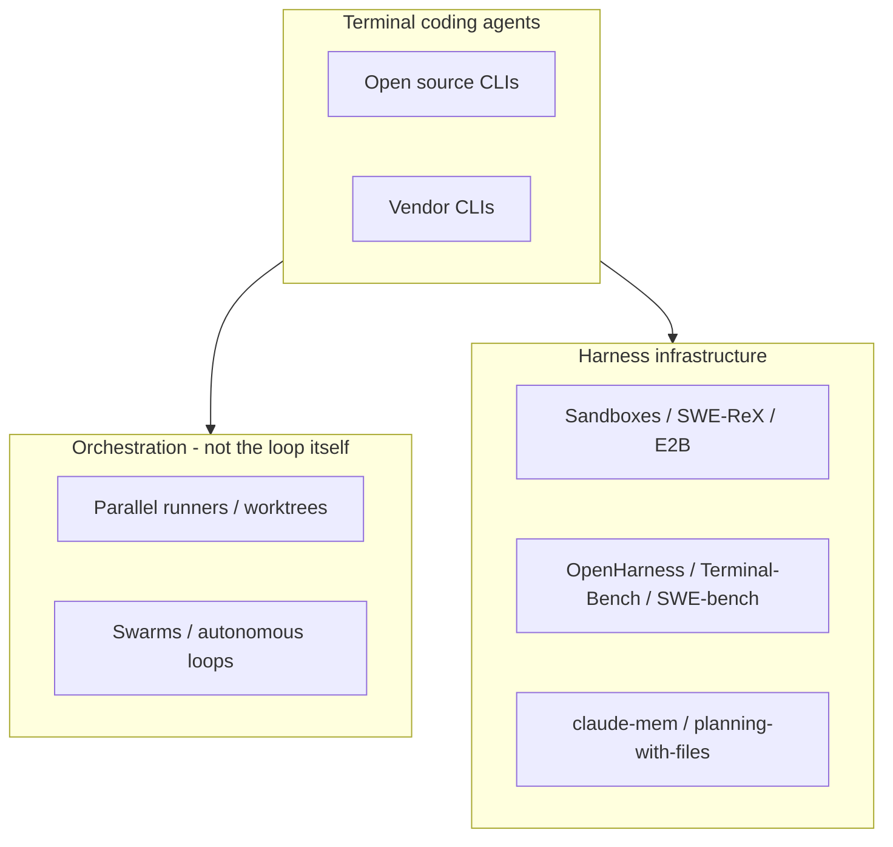

# Coding-agent harness landscape — research brief

**Purpose:** Map the **agent harness** ecosystem (CLI-first), compare philosophies (frontier-default vs model-agnostic), and extract **design patterns** for **muxon**: a frugal, tool-native, ZDR-aligned engineering agent starting as a **CLI**.

**Status:** High-level survey (Oct 2026). Star counts and names drift quickly — use linked repos for ground truth.

**Curated lists used:**

- [bradAGI/awesome-cli-coding-agents](https://github.com/bradAGI/awesome-cli-coding-agents) — **cloned locally**; full survey in [03-awesome-cli-coding-agents-survey.md](./03-awesome-cli-coding-agents-survey.md)
- [xiashuqin89/awesome-agent-harness](https://github.com/xiashuqin89/awesome-agent-harness) (implementation-first, 145 entries)
- [ai-boost/awesome-harness-engineering](https://github.com/ai-boost/awesome-harness-engineering) (patterns, evals, MCP, memory)

**Architecture spec:** [../harness-architecture/README.md](../harness-architecture/README.md) — component docs and ADRs before implementation.

---

## 1a. muxon product requirements (evaluation lens)

Everything in this landscape is filtered against what you described building:

| Requirement | Implication for harness design |
|-------------|--------------------------------|
| **Frugal inference** | Default **small OSS** models (e.g. DeepInfra); not “one big loop on Sonnet.” |
| **Harness > model** | Loop, tools, context, and verification do the heavy lifting; model is swappable. |
| **Anti–frontier-default** | Avoid designs that assume unlimited context and verbose outputs “because the model can handle it.” |
| **ZDR** | Client-owned session state; supplier path that does not retain prompts (OSS on DeepInfra). |
| **CLI first** | Headless `run`, traces, later daemon/`serve` — not IDE-first. |
| **Escalation** | Cheap path for 80–90% of steps; larger model only on evidence (tests fail, planner stuck). |
| **Cost visibility** | Per-turn and per-task **tokens + $** — rare in the awesome list; core differentiator. |

**What “frontier harnesses” usually optimize for:** subscription UX, long chat history, browser/MCP breadth, multi-agent spectacle — often **one model class** and **high token burn**. muxon optimizes **engineering tasks per dollar** with similar **merge/test outcomes**.

---

## 1b. awesome-cli-coding-agents — what we pulled down

| Item | Detail |
|------|--------|
| **Mirror path** | `docs/research/_sources/awesome-cli-coding-agents/` |
| **README date** | 2026-10-12 |
| **Parsed entries** | **381** bullets → `awesome-cli-coding-agents-parsed.json` |
| **Sections** | ~106 OSS agents, 12 OpenClaw, 18 closed-source, 85 session managers, 51 orchestrators, 126 infrastructure |

**Takeaway:** Most entries are **not** alternative harness cores — they are **wrappers** (parallel tmux), **swarms**, or **infra**. For architecture, prioritize **Tier A** in [03-awesome-cli-coding-agents-survey.md](./03-awesome-cli-coding-agents-survey.md) (~20 projects), not all 381.

---

## 1. What is a “harness”?

A **harness** is everything **around** the model that makes coding agents reliable:

| Layer | Responsibility |
|-------|----------------|
| **Loop** | Prompt → model → tool calls → execute → observe → repeat until done |
| **Tools** | FS, shell, git, search, LSP, browser, MCP |
| **Context** | What enters the prompt (and what never should) |
| **Policy** | Permissions, approvals, sandbox, network egress |
| **State** | Sessions, checkpoints, memory, compaction |
| **Provider** | API keys, routing, failover, local inference |
| **Eval** | Traces, benchmarks, regression suites |

**Framework** (LangGraph, CrewAI) = general orchestration. **Coding harness** = opinionated loop optimized for repos.

**Thesis alignment:** Winners for muxon are harnesses that treat **model as interchangeable** and **tokens as cost**, not products that assume one frontier model.

---

## 2. Taxonomy



| Category | Examples | Relevance to muxon |
|----------|----------|---------------------------|
| **Model-agnostic OSS CLI** | Ante, OpenCode, Aider, Goose, Pi, Nanocoder, Codewhale | **Primary design references** |
| **Frontier-tuned vendor CLI** | Claude Code, Codex CLI, Cursor CLI, Copilot CLI | UX + safety patterns; weak on cheap-model default |
| **IDE agents** | Cline, Continue, Roo Code | Editor integration later; context lessons |
| **Research / bench agents** | SWE-agent, OpenHands, Agentless | Tool schemas + eval methodology |
| **Clean-room harness labs** | opencode-harness, HKUDS OpenHarness | **Eval + provider abstraction** |
| **Orchestrators** | Orca, Multica, Agent Orchestrator | Out of scope for v0 CLI |
| **Personal assistant runtimes** | OpenClaw ecosystem | Skills/channels; different product |

---

## 3. Spectrum: frontier-default vs universal model

| Pole | Behavior | Examples |
|------|----------|----------|
| **Frontier-default** | Best experience on Sonnet/GPT-Codex; subscriptions; “Zen” validated models | Claude Code, Codex CLI, Cursor; OpenCode **Zen** tier pushes validated frontier models |
| **Universal** | BYO key, OpenAI-compatible, local GGUF, catalog.json | **Ante**, Goose, Aider, Pi, OpenCode (general), Codewhale, Nanocoder |
| **Hybrid** | Default cheap route + escalation | Codewhale fleets, Reasonix split planner/executor, OpenSquilla ML tier routing |

**muxon target:** **Universal + hybrid routing + explicit $/turn metrics** — closer to **Ante** and **Aider** than to **Claude Code**.

---

## 3a. Frontier loop vs frugal loop (techniques)

Many harnesses in the awesome list implement a **single loop**: append full tool output to history → resend entire thread → hope the model self-corrects. That works when context is cheap and models are strong; it fails your economics on mid-tier OSS models.

| Technique | What it does | Examples from list / research |
|-----------|--------------|-------------------------------|
| **Retrieve, don’t paste** | Grep/repo map/symbol index before `read` | Aider, Zap (SQLite index) |
| **Patch, don’t rewrite** | Small unified diffs | Aider, Codex-style patches |
| **Rule elision → then summarize** | Drop noise (failed attempts, huge logs) before LLM compaction | [Empirical harness study](https://arxiv.org/abs/2609.20804) |
| **Truncate/drop only** | No LLM rewrite of history (less drift) | CliffCompaction |
| **Turn summaries** | Replace raw tool traces in context | Keen Code TurnMemory |
| **Tiered compaction** | Multiple compaction levels by age/importance | Waveloom |
| **Plan/act split** | Cheap plan artifact; worker executes | Plandex, Cline, Reasonix |
| **Model routing** | Classifier + worker + escalator | Codewhale fleets, OpenSquilla |
| **Prompt cache layout** | Stable system + tools prefix | Waveloom + DeepInfra caching |
| **Verify gate** | Tests/linter before `finish` | zeroshot, SWE-agent, MartinLoop budgets |
| **Bash-only action space** | Fewer tool tokens for capable models | arXiv:2609.20804 finding |
| **Graph / batch tools** | Fewer round-trips | Tura (evaluate for muxon) |

**Academic / industry research to fold into architecture (see §3b):**

- [An Empirical Study of Harness Design for Coding Agents](https://arxiv.org/abs/2609.20804) — modular ablations; **context management** matters most under tight budgets; **elision before summarization**; planning helps cost on strong models.  
- [AutoCompact](https://autocompact.github.io/) — learned when to compact, not fixed threshold.  
- [CompactionRL](https://arxiv.org/pdf/2607.05378) — RL-trained compaction for long horizons.  
- [Slipstream](https://arxiv.org/pdf/2605.08580) — async compaction validation against continued trajectory.  
- [CliffCompaction](https://arxiv.org/pdf/2609.26779) — drop/truncate only; strong cost claims on Terminal-Bench; proxy-friendly.

---

## 3b. Mapping awesome-list clusters → muxon layers

| muxon layer | Best list references |
|--------------------|----------------------|
| Provider + catalog | Ante, Nanocoder, Continue, OpenCode config |
| Edit / apply | Aider, Codewhale |
| Context | Keen Code, Waveloom, Zap, BitFun |
| Routing | Codewhale, OpenSquilla, Reasonix, Agent AFK |
| Policy / cost | MartinLoop, DvalinCode, iris, Claudescope |
| Verify | zeroshot, SWE-agent, Bernstein |
| Surfaces | Ante daemon, OpenCode LSP (later) |
| **Not v0** | Orca, Multica, DeerFlow, OpenClaw fleet |

---

## 4. Deep dives — projects to study

### 4.1 Ante (Antigma Labs) — **primary reference for model-agnostic CLI**

- **Repo / site:** [AntigmaLabs/ante](https://github.com/AntigmaLabs/ante), [docs.antigma.ai](https://docs.antigma.ai/), [ante.run](https://ante.run/)
- **Philosophy:** “**The harness, not a bound model**” — prompts belong to the user; optimize the loop per model.
- **Distribution:** Single **~15MB Rust** binary; minimal deps; preview status.
- **Architecture:** **Client–daemon** — daemon owns turn lifecycle (prompt, tools, confirm, execute); clients = TUI, headless CLI, WebSocket/`ante serve`, gateway for bots.
- **Providers:** 12+ presets (Anthropic, OpenAI, Gemini, Grok, DeepSeek, OpenRouter, …) + **`~/.ante/catalog.json`** for any OpenAI-compatible endpoint (**DeepInfra fits here**).
- **Local:** Embedded **llama.cpp** for **GGUF offline** — no API key.
- **Profiles:** `--profile` swaps system prompt, tools, skills, memory — same binary, different agents.
- **Benchmark narrative:** Terminal-Bench style comparisons holding **model constant** across harnesses — exactly the right methodology for muxon marketing.

**Borrow for muxon:**

- Daemon + headless CLI separation (IDE later without rewriting loop)
- `catalog.json` provider registry
- Profile-based behavior
- Offline/local path for air-gapped devs
- Evidence-based “harness vs harness” eval story

---

### 4.2 OpenCode — **distribution + LSP + multi-surface**

- **Site:** [opencode.ai](https://opencode.ai/) — very large OSS community.
- **Surfaces:** Terminal, desktop, IDE extension.
- **Providers:** 75+ via Models.dev; OpenRouter/Vercel gateway cookbooks.
- **Strengths:** **LSP auto-load**, multi-session, share links, privacy positioning (no code storage in product).
- **Tension:** **Zen** = hand-picked **frontier** models for coding — aligns with “quality default,” not frugal default. Config still allows any model (e.g. DeepInfra via OpenRouter or custom provider).

**Borrow:**

- LSP integration pattern
- `opencode.json` provider/model config ergonomics
- Client-server runtime (multi-session)
- Privacy messaging structure

**Avoid as default strategy:**

- Implicit push toward latest `~anthropic/...-latest` aliases on OpenRouter

---

### 4.3 Aider — **diff-first, git-native, token discipline OG**

- **Repo:** [Aider-AI/aider](https://github.com/Aider-AI/aider)
- **Strengths:** **Unified diffs**, repo map, strong git workflow, many models, scripting-friendly.
- **Weakness vs modern agents:** Less “agent OS” (subagents, MCP ecosystem) than OpenCode/Ante — but **best-in-class edit format**.

**Borrow:**

- Edit via **patch/diff**, not full file rewrite
- Repo map / context selection instead of whole-tree paste
- `--message` / CI usage patterns

---

### 4.4 Pi (pi-mono) — **minimal harness toolkit**

- **Ecosystem:** Base for Prime Agent, OH-MY-PI, Microsoft integrations; DeepInfra has [Pi integration doc](https://docs.deepinfra.com/integrations/pi).
- **Strengths:** Small core, skills, MCP, unified LLM API — good **reference implementation** size.

**Borrow:**

- Minimal loop clarity (teachability)
- Skills as files

---

### 4.5 Goose — **local + MCP + Block**

- **Repo:** [block/goose](https://github.com/block/goose)
- **Strengths:** Local-first narrative, MCP extensions, enterprise-friendly.

**Borrow:**

- MCP as extension plane
- Permission prompts for destructive tools

---

### 4.6 Codex CLI & Claude Code — **frontier reference UX**

| | Codex CLI | Claude Code |
|---|-----------|-------------|
| **License** | Apache-2.0 CLI | Source-available, proprietary |
| **Model** | OpenAI stack | Anthropic stack |
| **Patterns** | Sandbox, cloud offload, subagents, MCP | Plan mode, hooks, skills, strong repo tools |

**Borrow:** Plan mode, hooks (pre-tool), slash commands, subagent boundaries — reimplement without vendor lock-in.

**Do not borrow:** Subscription-only auth as sole path; implicit unlimited context.

---

### 4.7 Continue / Cline — **IDE harness patterns**

- **Continue:** Multi-model, local models, config-driven — good **provider matrix**.
- **Cline:** Autonomous loop, browser, checkpoints — good **approval UX**.

**Borrow for later IDE plugin:** Checkpoint restore, browser only when necessary (token burn).

---

### 4.8 OpenHands / SWE-agent — **autonomous SE research**

- **OpenHands:** Full dev environment, web UI — heavy for v0 CLI.
- **SWE-agent:** Issue-resolution focus, benchmark culture.

**Borrow:** Trajectory logging, benchmark task suites, failure taxonomy.

---

### 4.9 Codewhale — **multi-model fleets**

- Rust agent; **per-role model pinning** (cheap directs expensive); headless `exec`; snapshots/`/undo`.

**Borrow:** **Fleet routing** — planner on 8B, coder on Qwen-Coder, reviewer on 70B.

---

### 4.10 opencode-harness (clean-room) — **eval + provider lab**

- **Repo:** [samarailly51-pixel/opencode-harness](https://github.com/samarailly51-pixel/opencode-harness)
- **Focus:** Model-agnostic **tool system**, JSONL traces, eval reports, **Model Labs** (DeepSeek, Qwen, local vLLM/Ollama).

**Borrow:**

- Trace format + HTML/Markdown reports for regression
- Permissioned tool surface (read/write/patch/shell/git/todo/finish)
- Mock provider for CI

---

### 4.11 HKUDS OpenHarness / OpenHarness (community) — **Claude Code-shaped OSS**

- Multiple repos use “OpenHarness” name — see awesome lists.
- Themes: slash commands, many tools, MCP, hooks, plan mode, multi-provider.

**Borrow:** Feature checklist parity for enterprise eval (“does your CLI support plan mode + hooks?”).

---

### 4.12 Context-efficiency specialists (smaller but on-target)

| Project | Idea |
|---------|------|
| **Keen Code** | TurnMemory summaries instead of raw tool traces |
| **Zap** | Skill-first context injection; SQLite code index |
| **Waveloom** | Tiered compaction, subagent modes, DeepSeek cache-aware prompts |
| **DvalinCode** | Policy engine, egress sandbox, audit hash chain |
| **Agent AFK** | Unattended runs, trace receipts, model routing |
| **Smelt / agentty** | Rust TUIs, permission systems, static binaries |

**Borrow:** Compaction tiers + **audit trail** for team tier.

---

## 5. Landscape table (CLI coding agents — selected)

Sorted roughly by relevance to **frugal universal CLI**, not just stars.

| Project | Stars (approx.) | Model stance | Distinctive harness feature |
|---------|-----------------|--------------|-----------------------------|
| OpenCode | 200k+ | Universal + Zen frontier | LSP, multi-session, desktop/IDE |
| Codex CLI | 100k+ | OpenAI | Sandbox, subagents |
| Pi | 90k+ | Universal | Minimal core, skills |
| Goose | 50k+ | Universal + MCP | Local extensibility |
| Aider | 48k+ | Universal | Diff/git context |
| Cline CLI | 66k+ | Universal | Plan/browser/checkpoints |
| Codewhale | 40k+ | BYOM + fleets | Role-based model pinning |
| Continue CLI | 35k+ | Universal | Config providers |
| Reasonix | 34k+ | Config.toml providers | Long-run, checkpoints |
| Nanocoder | 2k+ | BYOM + Ollama | File-based commands/tools |
| **Ante** | ~2k (preview) | **Universal + offline GGUF** | **Daemon, catalog.json, profiles** |
| opencode-harness | small | Universal | Eval labs + traces |
| OpenSquilla | 6k+ | 20+ providers | ML tier routing, sandbox |
| Tau | 2k+ | Teaching harness | Small readable Python |
| VT Code | 800+ | Multi-provider failover | Shell safety |

*Full 110+ list: [awesome-cli-coding-agents](https://github.com/bradAGI/awesome-cli-coding-agents).*

---

## 6. Orchestrators (intentionally out of v0 scope)

Tools like **Orca**, **Multica**, **Agent Orchestrator**, **vibe-kanban** run **many** agent CLIs in parallel worktrees. Useful **after** muxon is a credible single-session CLI.

**Future integration:** Expose JSONL/`serve` like Ante so orchestrators can drive muxon as a worker.

---

## 7. Harness engineering patterns (from awesome-harness-engineering)

Cross-cutting practices worth baking into muxon v1:

| Pattern | Source inspiration | muxon action |
|---------|-------------------|---------------------|
| **Verification gate** | Harness engineering (OpenAI), SWE-bench culture | No “done” without test/lint command |
| **Tool design** | Anthropic “effective tools” | Few tools, strict schemas, small outputs |
| **Context as budget** | Context engineering handbooks | Hard caps + summarization with citations |
| **Plan → act split** | Cline plan mode, Plandex | Cheap model plans; expensive only on execute if needed |
| **Skills as artifacts** | everything-claude-code, Antigravity skills | `skills/` directory, versioned |
| **MCP optional** | Goose, Gemini CLI | Phase 2; don’t block v0 |
| **Traces / eval** | opencode-harness, Terminal-Bench | JSONL per session; nightly flex-tier eval on DeepInfra |
| **Permissions** | DvalinCode, Smelt, Codex sandbox | Tiered: read-only → patch → shell |
| **Long-run reliability** | Effective harnesses for long-running agents | Checkpoints, resumable sessions |

---

## 8. Influence matrix — what to take from where

| Need | Primary influence | Secondary |
|------|-------------------|-----------|
| **Provider plug-in (DeepInfra)** | Ante `catalog.json` | OpenCode provider config, Continue |
| **Edit mechanics** | Aider diffs | Codex patch format |
| **Loop clarity** | Pi / Tau | opencode-harness tool modules |
| **LSP** | OpenCode | Reasonix, jcode |
| **Offline / local** | Ante llama.cpp | Ollama path in Nanocoder |
| **Model routing** | Codewhale fleets | OpenSquilla tier router |
| **Context compaction** | Keen Code, Waveloom | Claude Code compaction ideas |
| **Cost visibility** | (gap in market) | **muxon differentiator** |
| **ZDR / no body logs** | OpenCode privacy copy + DeepInfra OSS models | DvalinCode audit chain for teams |
| **Regression testing** | opencode-harness labs | SWE-agent tasks |
| **Headless CI** | `codewhale exec`, Codex `-p` | Aider scripting |
| **Daemon for IDE** | Ante `serve` | OpenCode client-server |

---

## 9. OpenCode vs Ante — your framing

| Dimension | OpenCode | Ante |
|-----------|----------|------|
| **Default philosophy** | Mass adoption; Zen validates **frontier** coders | Optimizes loop for **any** model; benchmarks harness fairness |
| **Local inference** | Supported via providers | **First-class** embedded GGUF |
| **Size / deps** | Larger ecosystem (TS/desktop) | Single Rust binary |
| **DeepInfra** | Via OpenRouter or custom OpenAI base URL | Via `catalog.json` OpenAI-compatible entry |
| **Best for muxon** | LSP + distribution ideas | **Core loop + provider abstraction + serve protocol** |

**Positioning line:** “Ante-grade model freedom + Aider-grade edits + OpenCode-grade LSP (roadmap) + **token/$ dashboard** DeepInfra defaults.”

---

## 10. Recommended v0 CLI architecture (synthesis)

```
muxon CLI
├── commands: chat | run -p "..." | doctor | cost-report
├── loop: plan (optional) → act → verify → escalate?
├── providers: deepinfra (default) | openrouter | ollama | catalog.json
├── tools: grep | read | patch | shell (gated) | test
├── context: repo map + retrieval (no full tree)
├── session: local JSONL trace only (ZDR server mode = no upload)
└── routing: router model (8B) → worker (Qwen-Coder) → escalator (DS V3.2)
```

**Non-goals for v0:** Desktop app, MCP marketplace, multi-agent kanban, hosted proxy (can follow once loop proves 3× cost win on benchmark tasks).

---

## 11. Competitive gaps (opportunities)

1. **Transparent $/task and tokens/task** on every completion (most harnesses hide provider cost).
2. **Pinned OSS model manifest** with migration when DeepInfra deprecates SKUs.
3. **Strict ZDR mode** — block Google/Anthropic routes; OSS-only on DeepInfra.
4. **Anti-slop defaults** — max output tokens, patch-only edits, mandatory verify step.
5. **Prompt cache-aware prompt layout** — document structure for DeepInfra cached prefixes.

---

## 12. Suggested eval basket (prove harness)

Hold constant across harness comparisons (Ante methodology):

1. Fix failing unit test from traceback  
2. Add small feature with existing test patterns  
3. Lint/type error cleanup across 2 files  
4. Dependency bump with changelog  
5. Refactor rename with grep-backed consistency  

Metrics: **success**, **wall time**, **input/output tokens**, **$ (DeepInfra list)**, **escalation rate**.

Run baseline: “fat context + single frontier model” vs muxon routing.

---

## 13. References

### Agents & harnesses
- Ante: https://github.com/AntigmaLabs/ante  
- OpenCode: https://opencode.ai/  
- Aider: https://github.com/Aider-AI/aider  
- Pi (pi-mono toolkit): see [awesome-cli-coding-agents](https://github.com/bradAGI/awesome-cli-coding-agents) entry  
- Goose: https://github.com/aaif-goose/goose (per awesome list; verify fork)  
- OpenHands: https://github.com/All-Hands-AI/OpenHands  
- Codewhale: https://github.com/Hmbown/CodeWhale  
- opencode-harness: https://github.com/samarailly51-pixel/opencode-harness  

### Lists
- https://github.com/bradAGI/awesome-cli-coding-agents  
- https://github.com/xiashuqin89/awesome-agent-harness  
- https://github.com/ai-boost/awesome-harness-engineering  

### Reading (harness theory)
- OpenAI “Harness engineering” field report (via awesome lists)  
- Anthropic: effective tools, long-running agents, scaling managed agents  
- [arXiv:2609.20804](https://arxiv.org/abs/2609.20804) — empirical harness components  
- AutoCompact, CliffCompaction, Slipstream, CompactionRL (links in §3a)

### Awesome list (local)
- [03-awesome-cli-coding-agents-survey.md](./03-awesome-cli-coding-agents-survey.md)  
- Clone: `docs/research/_sources/awesome-cli-coding-agents`

---

## 14. Next research passes

- [x] Clone and survey [bradAGI/awesome-cli-coding-agents](https://github.com/bradAGI/awesome-cli-coding-agents)  
- [ ] Expand [harness-architecture/](../harness-architecture/README.md) per-component docs (sequence diagrams + interfaces)  
- [ ] Tier A repo deep dives (read source: loop, compaction, routing)  
- [ ] Wire DeepInfra model manifest (top 10 coder SKUs + cache columns)  
- [ ] Terminal-Bench / SWE-bench task subset selection  
- [ ] Legal: DeepInfra ToS + resale if operating a proxy  
- [ ] Prototype: Ante + DeepInfra `catalog.json` snippet in `examples/`  
