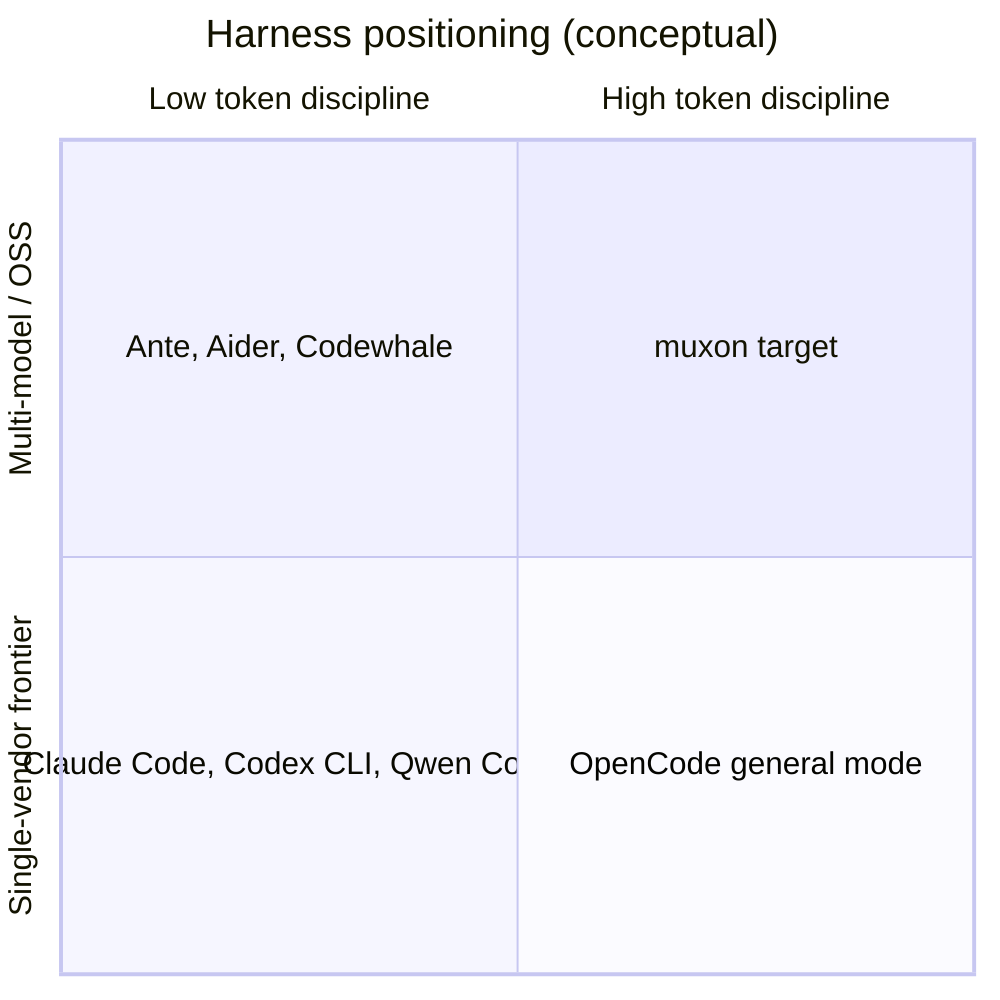

# Survey: [awesome-cli-coding-agents](https://github.com/bradAGI/awesome-cli-coding-agents)

**Local mirror:** `docs/research/_sources/awesome-cli-coding-agents` (shallow clone, README dated **2026-10-12**).  
**Machine parse:** `docs/research/_sources/awesome-cli-coding-agents-parsed.json` (381 linked entries extracted from README bullets).

This document catalogs what the list contains, classifies projects by **fit for muxon**, and records **what to steal** vs **what to avoid** (frontier-default loops).

---

## 1. What this repo is (and is not)

| | |
|--|--|
| **Is** | A curated **README awesome list** + star-update automation (`scripts/update-stars.py`). Not a framework monorepo. |
| **Is not** | Unified benchmarks, shared harness SDK, or maintained taxonomy schema. |
| **Scale (Oct 2026)** | **130+** CLI agents claimed; **381** bullet entries parsed (includes orchestrators + infrastructure). |

### 1.1 Top-level sections (entry counts from parse)

| Section | ~Entries | Role relative to muxon |
|---------|----------|-------------------------------|
| **Open Source** (terminal agents) | 106 | **Primary** — actual coding harnesses |
| **OpenClaw ecosystem** | 12 | Personal-assistant runtime; skills/channels — peripheral |
| **Closed Source** | 18 | UX reference; often frontier + subscription |
| **Session managers & parallel runners** | 85 | **Later** — fleet/worktree layers on top of your CLI |
| **Orchestrators & autonomous loops** | 51 | **Later** — Ralph loops, verifier councils |
| **Agent infrastructure** | 126 | Sandboxes, memory plugins, hooks — **pick individual tools** |

---

## 2. muxon goals (evaluation lens)

Use this checklist when scoring any project from the list:

1. **Model-agnostic** — OpenAI-compatible APIs (DeepInfra default), optional local GGUF/Ollama.
2. **Token economics** — retrieval, compaction, routing, patch edits; not “send the repo every turn.”
3. **Verification-first** — tests/linter as gate; no “done” without evidence.
4. **ZDR posture** — no server-side prompt storage; OSS inference path preferred.
5. **CLI-first** — headless `run`, JSONL traces, later `serve` for IDE.
6. **Escalation** — cheap worker model + rare frontier/MoE escalation.
7. **Cost transparency** — $ and tokens per task (market gap).

**Anti-patterns for us:** implicit 1M-context dumps, subscription-only auth, Zen/frontier-only defaults, browser-heavy loops, multi-agent kanban before core loop works.

---

## 3. Frontier-default vs frugal-universal (list-wide pattern)

| Cluster | Examples from list | Typical loop | Fit |
|---------|-------------------|--------------|-----|
| **Vendor frontier CLI** | Codex CLI, Gemini CLI, Qwen Code, Grok Build, Kimi CLI | Large context, strong tools, tuned for one API | Borrow UX/safety; not default stack |
| **Universal OSS CLI** | Ante, Goose, Aider, Pi, Nanocoder, Continue CLI | BYOM; quality varies by model | **Core references** |
| **Hybrid fleets** | Codewhale, OpenSquilla, Reasonix, Oh My OpenAgent | Per-role models, routing | **Routing layer** |
| **Context specialists** | Keen Code, Waveloom, Zap, Tura, BitFun | Compaction, graphs, skill-first context | **Context layer** |
| **Governance / cost** | DvalinCode, MartinLoop, Agent AFK, iris | Budgets, audit, approvals | **Team tier** |
| **Eval / clean-room** | SWE-agent, opencode-harness (not all in parse), Tau | Traces, benches | **Quality system** |
| **Orchestrators** | Orca, Multica, zeroshot, h5i | Many agents, worktrees | Phase 2+ |

---

## 4. Tier A — study deeply for muxon (curated)

Projects chosen for **overlap with frugal + universal + engineering**, not raw stars.

### 4.1 Core loop & providers

| Project | Stars | What it does | Borrow |
|---------|-------|--------------|--------|
| **[Ante](https://github.com/AntigmaLabs/ante-preview)** | ~2k | Rust binary; client–daemon; `catalog.json`; offline GGUF; profiles | Provider registry, `serve`, harness-is-not-model philosophy |
| **[Aider](https://github.com/Aider-AI/aider)** | ~49.5k | Diff/patch git-centric pair programming | Edit format, repo map, scripting |
| **[Codewhale](https://github.com/Hmbown/CodeWhale)** | ~41.1k | Rust; 30+ providers; **fleets** (cheap directs expensive); `exec` | Multi-model roles, undo/snapshots |
| **[OpenSquilla](https://github.com/opensquilla/opensquilla)** | ~7.1k | Microkernel runtime; **ML tier routing**; sandbox | Router + policy |
| **[Nanocoder](https://github.com/Nano-Collective/nanocoder)** | ~2.5k | BYOM; XML tool fallback; file-defined tools | Simplicity, local-first |
| **[Tau](https://github.com/huggingface/tau)** | ~3k | Small Python harness; JSONL sessions + branching | Teachable loop structure |
| **[Pi](https://github.com/badlogic/pi-mono)** | ~115k | Minimal harness toolkit; skills; MCP | Small core, extensions |
| **[Goose](https://github.com/aaif-goose/goose)** | ~55.2k | Local extensible agent; MCP | Extension model |

### 4.2 Context & token discipline

| Project | Stars | What it does | Borrow |
|---------|-------|--------------|--------|
| **[Keen Code](https://github.com/mochow13/keen-code)** | ~71 | **TurnMemory** vs raw tool traces | Compaction without losing intent |
| **[Waveloom](https://github.com/Menfre01/waveloom)** | ~134 | **4-tier compaction**; DeepSeek cache-aware prompts; subagent modes | Tiered compaction + cache layout |
| **[Zap](https://github.com/zap-coding-agent/zap-coding-agent)** | ~36 | Skill-first context; SQLite symbol index | No system-prompt bloat |
| **[Tura](https://github.com/Tura-AI/tura)** | ~654 | Command graph vs round-trip-per-tool; claims large token savings | Graph execution (evaluate claims) |
| **[BitFun](https://github.com/GCWing/BitFun)** | ~2.4k | fork/undo/**compact** timeline | Session timeline UX |
| **[Plandex](https://github.com/plandex-ai/plandex)** | ~15.7k | Plan-first multi-file (2M context — caution) | Plan/act separation, not 2M default |

### 4.3 Policy, cost, unattended

| Project | Stars | What it does | Borrow |
|---------|-------|--------------|--------|
| **[DvalinCode](https://github.com/arthurpanhku/dvalincode)** | ~117 | Policy engine, egress sandbox, hash-chained audit | Enterprise trust |
| **[MartinLoop](https://github.com/Keesan12/martin-loop)** | ~410 | Token/cost budgets, verifier passes, signed receipts | **Cost caps** (aligns with product) |
| **[Agent AFK](https://github.com/griffinwork40/agent-afk)** | ~59 | Editable loop; routing; trace receipts; headless daemon | Unattended + audit |
| **[agentty](https://github.com/1ay1/agentty)** | ~617 | Static binary; sandbox default; many providers | Performance + sandbox |
| **[Smelt](https://github.com/leonardcser/smelt)** | ~54 | Plan/Apply modes; permissions; headless | Mode split |

### 4.4 Distribution & IDE-scale (secondary)

| Project | Stars | What it does | Borrow |
|---------|-------|--------------|--------|
| **[OpenCode](https://github.com/anomalyco/opencode)** | ~213k | LSP, multi-session, privacy story | LSP + surfaces (watch **Zen** frontier bias) |
| **[Reasonix](https://github.com/esengine/DeepSeek-Reasonix)** | ~35.8k | Planner/executor split; checkpoints | Split models |
| **[Continue CLI](https://github.com/continuedev/continue)** | ~36.2k | Provider matrix | Config patterns |

### 4.5 Verification & multi-agent (orchestration ideas)

| Project | Stars | What it does | Borrow |
|---------|-------|--------------|--------|
| **[zeroshot](https://github.com/the-open-engine/zeroshot)** | ~2k | Planner + implementer + validators in isolation | Verify loop |
| **[SWE-agent](https://github.com/SWE-agent/SWE-agent)** | ~20.5k | SWE-bench agent | Tool schemas + eval culture |
| **[h5i](https://github.com/h5i-dev/h5i)** | ~754 | Multiple candidates + neutral verifier merge | Expensive; good for hard tasks only |

---

## 5. Tier B — useful patterns, not primary forks

Large stars but **frontier-shaped** or scope too wide for v0:

| Project | Why Tier B |
|---------|------------|
| Hermes Agent | 300+ models but personal-assistant + channels |
| OpenHands | Full dev environment / web UI |
| Claw Code | Claude-shaped rewrite; leak-driven architecture |
| Codex / Gemini / Qwen CLIs | Vendor defaults |
| DeerFlow, claude-flow | Swarm / long-horizon meta-harness |
| Orca, Multica, Agent Orchestrator | Parallel CLIs — not your loop |
| OpenClaw* | Assistant OS, not repo engineer |

---

## 6. Tier C — orchestration & infrastructure (from list tail)

When muxon works, these wrap **your** CLI:

- **Session managers:** Orca, Paseo, Agent Orchestrator, taskpods, repomon  
- **Cost observability:** Claudescope, iris, Tempest (token intelligence)  
- **Sandboxes:** AgentBox, Omnigent, DeerFlow sandboxes, DeepInfra Sandboxes (see DeepInfra doc)  
- **Meta:** agents-cli (pin versions), showagent (transcript portability)

---

## 7. “What they do” — one-line taxonomy (Open Source agents)

Grouped for scanning; see README for full URLs and star counts.

| Group | Members (sample) |
|-------|------------------|
| **Diff/git editors** | Aider, ForgeCode, picocode |
| **Rust TUIs** | Codewhale, Crush, jcode, Smelt, Zap, BitFun, QQCode |
| **Go binaries** | Reasonix, Waveloom, Keen Code, DvalinCode, Podiom |
| **Python teachable** | Tau, SWE-agent, gptme, RA.Aid |
| **LangChain-shaped** | Deep Agents Code |
| **Plan-heavy** | Plandex, Roo Code modes, Cline CLI |
| **RLM / kernel-as-tool** | Prime Agent |
| **Vendor CLIs** | Codex, Gemini, Qwen, Grok Build, Kimi, Amazon Q |

---

## 8. Compared to muxon — gap analysis

| Capability | Common in list | muxon intent |
|------------|----------------|---------------------|
| BYOM / OpenAI-compatible | Many OSS entries | **Default DeepInfra OSS manifest** |
| Prompt caching layout | Rare (Waveloom called out) | **First-class** (stable prefix design) |
| $/task dashboard | Almost none (iris, Claudescope partial) | **Core differentiator** |
| Model routing | Some (Codewhale, OpenSquilla) | **Router + escalation policy** |
| Compaction | Many ad hoc | **Rule elision → summarize** (see papers) |
| ZDR | Marketing only on some | **Operational** (proxy + provider choice) |
| LSP | OpenCode, Crush, jcode | Roadmap after CLI loop |
| Multi-agent | Everywhere | **Deferred** |

---

## 9. Maintenance

- Re-clone or pull list periodically; stars drift (`update-stars` workflow upstream).  
- Re-run parse script if README format changes.  
- Next: per-repo **deep dives** (read `src/` for loop, tools, context) for Tier A only.

---

## 10. References

- Upstream: https://github.com/bradAGI/awesome-cli-coding-agents  
- Related: [02-harness-landscape.md](./02-harness-landscape.md), [../harness-architecture/README.md](../harness-architecture/README.md)
